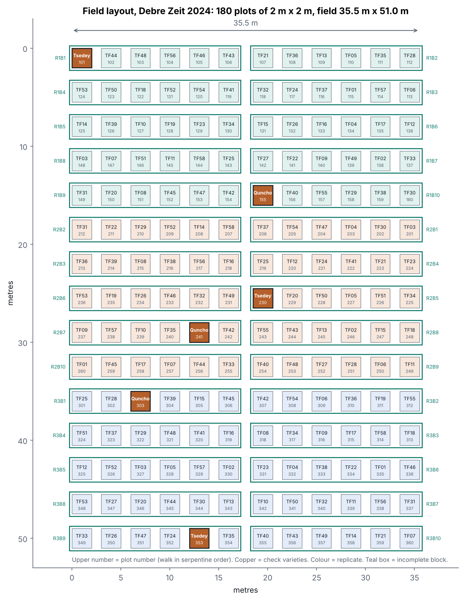
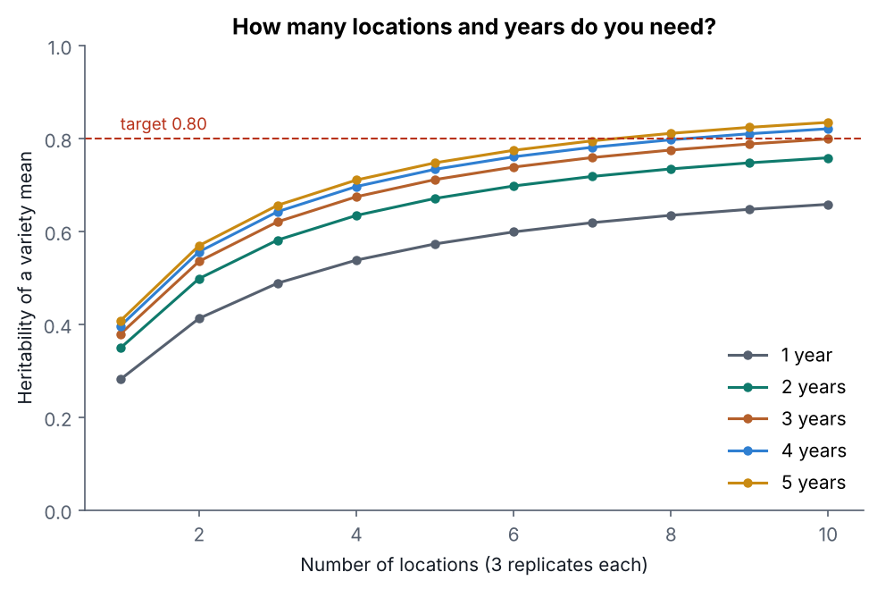
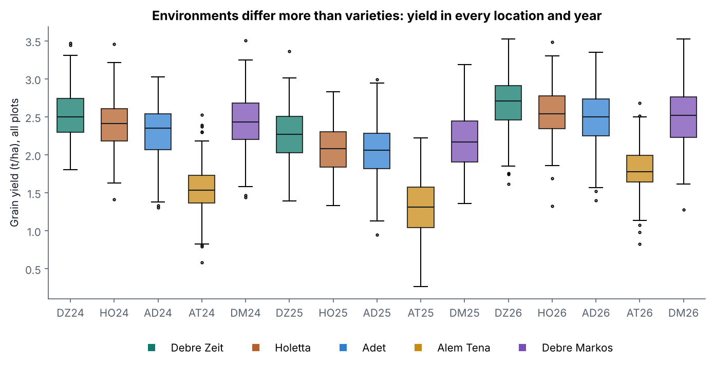
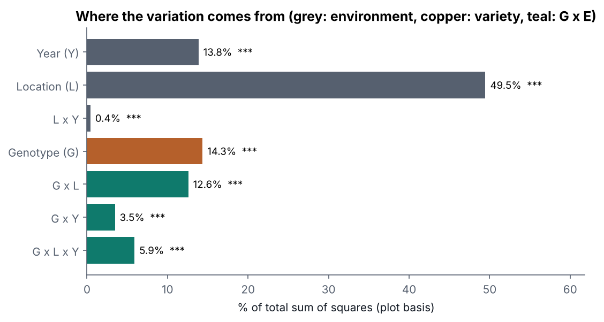
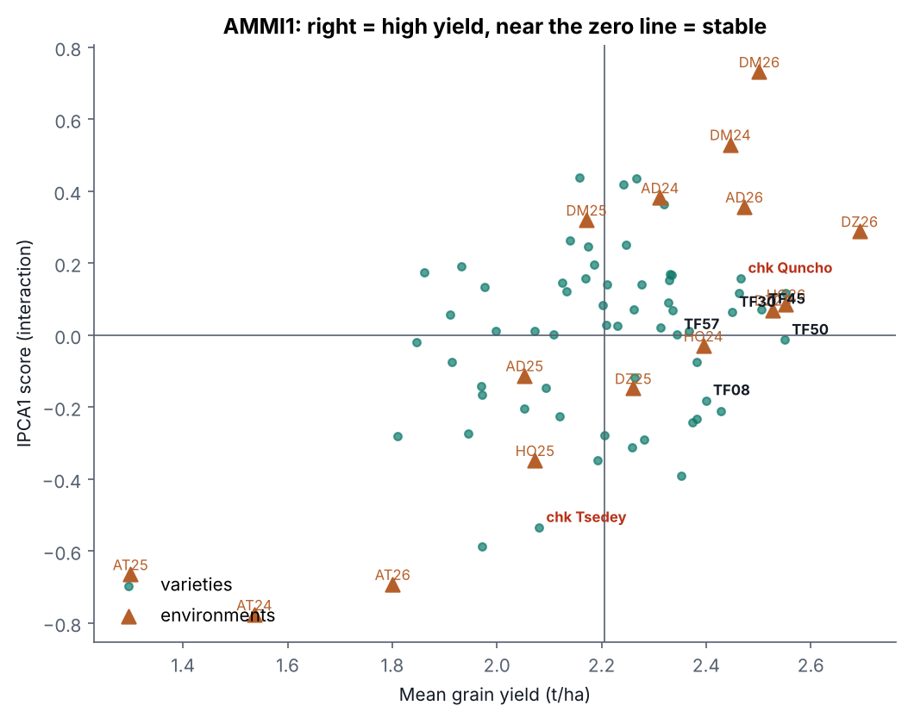
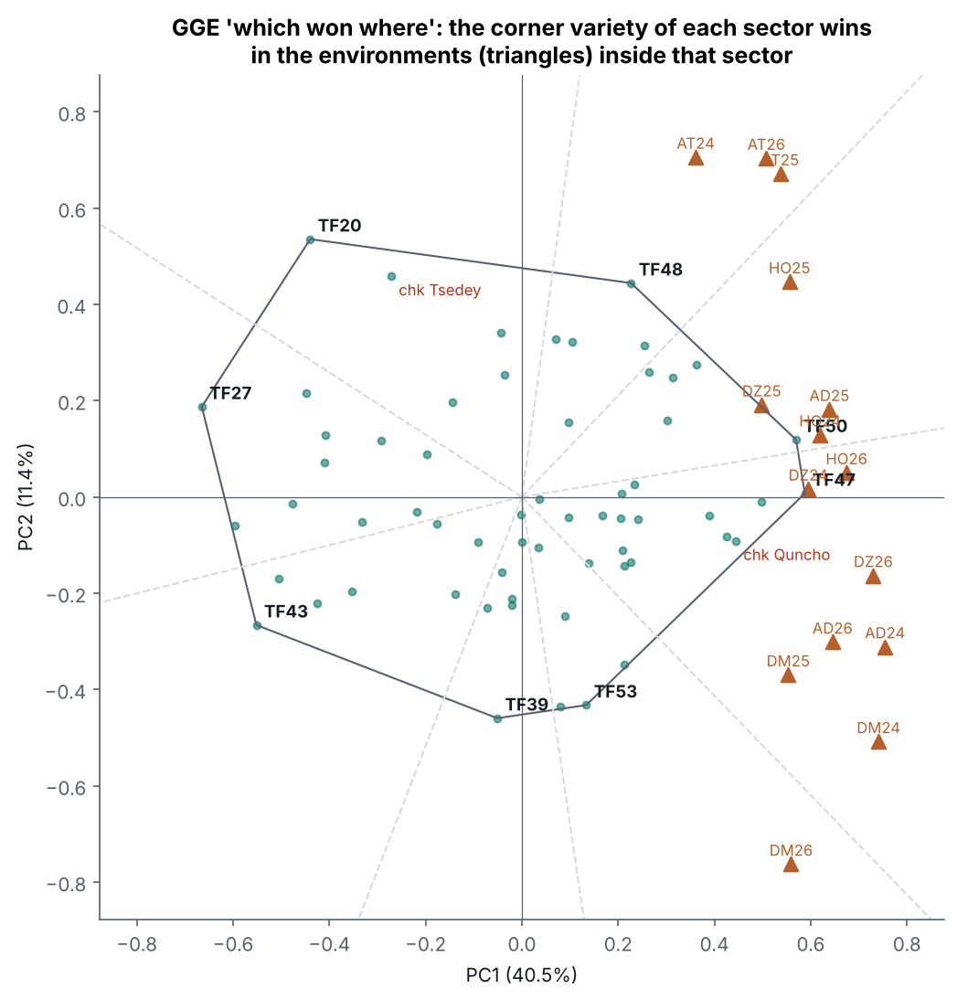
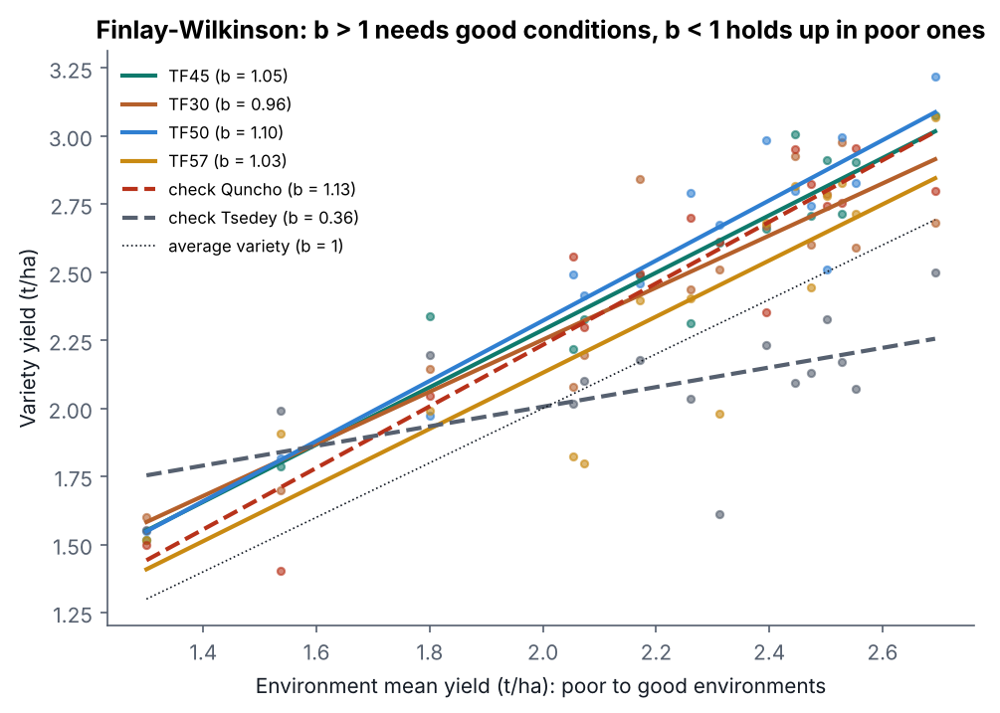
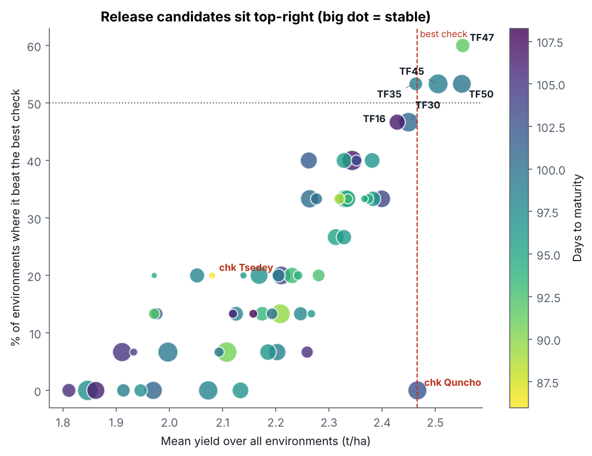
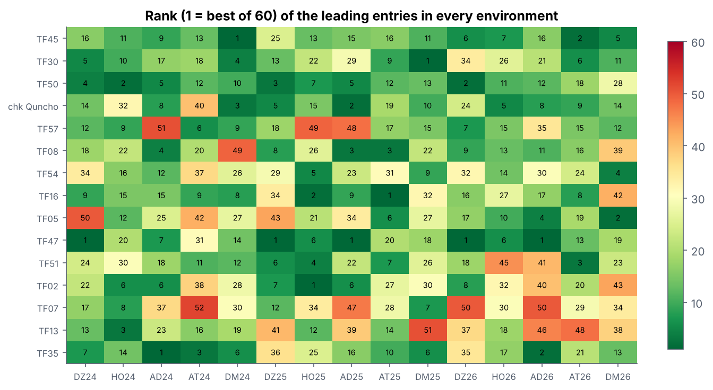

# Module 1 · Testing 60 teff varieties across locations and years

**ሞጁል 1 · 60 የጤፍ ዝርያዎችን በተለያዩ ቦታዎችና ዓመታት መሞከር**

> **The business question.** A breeder (or a seed company) has 58 new teff lines and must decide which to release, and *where*. Farmers pay for seed that wins in *their* field, in good years and bad. This module takes you from an empty field to that decision: design, field layout, data recording, every ANOVA, the G × E analysis, and the charts a release committee asks for.

The data here are **simulated for teaching**, with realistic Ethiopian values: trial practice follows published national teff trials (2 m × 2 m plots, three replications, alpha-lattice blocks), and the national average farm yield of teff is about 1.9 t/ha. Replace the data with your own field books and run the same script.

---

## 1. The trial plan

| Item | Choice | Why |
|---|---|---|
| Entries | 58 candidate lines + 2 checks = 60 | Checks: **Quncho** (high-potential areas) and **Tsedey** (low-moisture areas), so every line is compared with what farmers already grow |
| Design | Alpha-lattice, 3 replicates, 10 incomplete blocks of 6 plots per replicate | 60 plots in one block would span very different soil; small blocks of 6 remove that soil trend. Every pair of varieties shares a block at most once (checked by the script) |
| Plot | 2 m × 2 m = 4 m², rows 20 cm apart; 1 m between plots, 1.5 m between blocks | Standard for national teff trials |
| Field size per site | 35.5 m × 51.0 m ≈ **0.18 ha**, 180 plots | Fits on one research-station field |
| Seed | 12 g per plot (30 kg/ha); **36 g per variety per site, 2.16 kg per site** | Prepare and label seed packets before the season |
| Locations | Debre Zeit, Holetta, Adet, Debre Markos (high potential) and Alem Tena (low moisture) | Cover the target region, including the dry end |
| Years | 3 (2024–2026); the script handles 2 to 5 | Years differ in rainfall, which you cannot predict, so you need more than one |
| Randomisation | New for every site and every year | Field books are in [`fieldbooks/`](fieldbooks/) |
| Traits | Grain yield, days to maturity, plant height, lodging | Yield pays; maturity decides fit to the season |

### Field layout (one site, one year)



**How to lay it out:** peg the 35.5 m × 51 m rectangle, mark the 15 plot rows (every 3.5 m), and in each row two blocks of six 2 m plots. Walk the plots in serpentine order: plot 101 is top-left, plot 112 top-right, plot 113 starts back on the right. Sow, label each plot with its plot number (not the variety name, so scorers are not biased), and keep the field book in a plastic sleeve.

### Recording yield

Harvest the whole 4 m² plot (or a fixed net area if borders were damaged), thresh, clean and weigh the grain in grams. Convert:

```
yield (t/ha) = grams per plot ÷ (plot area in m² × 100)    e.g. 1,000 g ÷ (4 × 100) = 2.5 t/ha
```

Record days to maturity when about 90% of the panicles are mature, and note anything unusual (hail, waterlogging, birds) in the notes column. The analysis can only fix what you wrote down.

---

## 2. Step 1: analyse each site and year separately

For each of the 15 environments the script fits **replicate + block within replicate + variety**, with variety tested *after* removing the block effects.

ANOVA for Debre Zeit 2024:

| Source | df | SS | MS | F | p |
|---|---|---|---|---|---|
| Replication | 2 | 0.702 | 0.351 | 5.349 | 0.006 |
| Block(Rep), unadjusted | 27 | 2.097 | 0.078 | 1.183 | 0.273 |
| Genotype, adjusted | 59 | 12.043 | 0.204 | 3.110 | <0.001 |
| Residual | 91 | 5.973 | 0.066 |  |  |

Quality check for every environment:

| Env | Mean t/ha | CV % | LSD 5% | H² | Efficiency vs RCBD % |
|---|---|---|---|---|---|
| DZ24 | 2.53 | 10.14 | 0.42 | 0.68 | 111.00 |
| HO24 | 2.39 | 11.89 | 0.46 | 0.57 | 96.37 |
| AD24 | 2.31 | 8.95 | 0.34 | 0.83 | 94.79 |
| AT24 | 1.54 | 17.78 | 0.44 | 0.59 | 101.30 |
| DM24 | 2.45 | 9.68 | 0.38 | 0.78 | 117.09 |
| DZ25 | 2.26 | 11.62 | 0.43 | 0.63 | 101.85 |
| HO25 | 2.07 | 9.77 | 0.33 | 0.79 | 116.62 |
| AD25 | 2.05 | 11.12 | 0.37 | 0.76 | 103.90 |
| AT25 | 1.30 | 18.62 | 0.39 | 0.68 | 117.02 |
| DM25 | 2.17 | 10.44 | 0.37 | 0.75 | 125.68 |
| DZ26 | 2.69 | 8.57 | 0.37 | 0.77 | 107.51 |
| HO26 | 2.55 | 8.75 | 0.36 | 0.77 | 106.55 |
| AD26 | 2.47 | 10.02 | 0.40 | 0.74 | 97.93 |
| AT26 | 1.80 | 11.83 | 0.35 | 0.76 | 113.06 |
| DM26 | 2.50 | 10.71 | 0.43 | 0.65 | 120.69 |

**What to look at**

* **CV%** (coefficient of variation) should be below about 15–20%. Alem Tena, the dry site, is the noisiest, as dry sites usually are.
* **Efficiency vs RCBD** above 100% means the small blocks paid off: the same data analysed as an ordinary randomised complete block design would have had a larger error.
* **Heritability (H²)** shows how well one site ranks the varieties. One site alone is never enough.

## 3. Step 2: combined analysis over locations and years

Locations and years are treated as **random**: they stand for the farms and the future seasons where the variety will be grown. So the variety effect is tested against the interactions, not only against plot error.

| Source | df | SS | MS | F | p | % of SS |
|---|---|---|---|---|---|---|
| Year (Y) | 2 | 86.111 | 43.056 | 132.313 | <0.001 | 13.800 |
| Location (L) | 4 | 307.903 | 76.976 | 236.552 | <0.001 | 49.500 |
| L x Y | 8 | 2.603 | 0.325 | 5.586 | <0.001 | 0.400 |
| Genotype (G) | 59 | 89.283 | 1.513 | 3.464 | <0.001 | 14.300 |
| G x L | 236 | 78.254 | 0.332 | 4.270 | <0.001 | 12.600 |
| G x Y | 118 | 21.581 | 0.183 | 2.355 | <0.001 | 3.500 |
| G x L x Y | 472 | 36.655 | 0.078 | 1.333 | <0.001 | 5.900 |
| Pooled error | 1365 | 79.519 | 0.058 |  |  |  |

**What it means**

* The environment (location and year) causes most of the variation. That is normal and is not what you select on.
* **G × L (12.6% of SS) is much larger than G × Y (3.5%).** Variety ranking changes between *locations* in a repeatable way, but changes little between years. Repeatable differences can be used: recommend varieties for groups of locations, not for the whole country.
* Variance components (plot basis): genotype 0.0239, G × L 0.0282, G × Y 0.0070, G × L × Y 0.0065, error 0.0583.

## 4. Step 3: how many locations and years do you need?



With 5 locations, one year gives a heritability of **0.573**, three years **0.711**. Because G × L is large, adding locations helps more than adding years. Reaching 0.80 for the whole region needs about 8–10 locations; testing *within* each mega-environment (Step 4) is the cheaper way.

## 5. Step 4: AMMI and GGE: who wins where?





| Source | df | SS | MS | % of G x E | F | p |
|---|---|---|---|---|---|---|
| IPCA1 | 72 | 26.445 | 0.367 | 19.375 | 6.305 | <0.001 |
| IPCA2 | 70 | 24.148 | 0.345 | 17.692 | 5.922 | <0.001 |
| IPCA3 | 68 | 19.055 | 0.280 | 13.961 | 4.810 | <0.001 |
| IPCA4 | 66 | 14.990 | 0.227 | 10.982 | 3.899 | <0.001 |





The GGE biplot (PC1 40.5% + PC2 11.4% of variety + G × E variation) splits the environments into sectors. The variety at the corner of a sector wins there:

* **Low-moisture mega-environment (Alem Tena 2024, Alem Tena 2025, Alem Tena 2026): TF48 wins.** Over the three Alem Tena seasons it averaged 2.01 t/ha against 1.91 t/ha for the drought check Tsedey and 1.65 t/ha for Quncho.
* **High-potential mega-environment (Debre Zeit, Adet, Debre Markos, Holetta): TF47 and TF50 win.** TF47 averaged 2.77 t/ha against 2.67 t/ha for Quncho, and it matures about 11 days earlier.

## 6. Step 5: stability



A slope **b near 1** means the variety follows the environment like an average variety; **b > 1** means it needs good conditions to shine; **b < 1** means it holds up in poor conditions but cannot use good ones. The drought check Tsedey (b ≈ 0.36) is the classic "safe but low ceiling" type.

## 7. Step 6: the decision





Top entries by the yield–stability index (rank of mean yield + rank of AMMI stability value, smaller is better):

| Entry | Mean t/ha | % vs best check | % envs beating check | Worst env t/ha | b (FW) | ASV | Maturity days | Yield-stability index |
|---|---|---|---|---|---|---|---|---|
| TF45 | 2.51 | 1.58 | 53.33 | 1.52 | 1.05 | 0.11 | 98.80 | 8.00 |
| TF30 | 2.45 | -0.68 | 46.67 | 1.60 | 0.96 | 0.13 | 100.53 | 13.00 |
| TF50 | 2.55 | 3.39 | 53.33 | 1.55 | 1.10 | 0.18 | 99.62 | 13.00 |
| Check-Quncho | 2.47 | 0.00 | 0.00 | 1.41 | 1.13 | 0.18 | 102.76 | 14.00 |
| TF57 | 2.34 | -4.98 | 40.00 | 1.52 | 1.03 | 0.05 | 106.67 | 17.00 |
| TF08 | 2.40 | -2.72 | 33.33 | 1.69 | 0.84 | 0.20 | 103.80 | 26.00 |
| TF54 | 2.33 | -5.49 | 33.33 | 1.24 | 1.13 | 0.19 | 99.42 | 30.00 |
| TF16 | 2.43 | -1.54 | 46.67 | 1.79 | 0.78 | 0.23 | 106.84 | 33.00 |

### Recommendation

1. **Advance TF47 and TF50 to variety verification trials in high-potential areas.** TF47 beats Quncho in 60% of environments and matures earlier, which also helps farmers escape end-of-season drought.
2. **Advance TF48 for low-moisture areas** such as the Alem Tena corridor. It is not the best nationally, but it is the best where farmers have the fewest options.
3. **Keep TF45** as the most *widely* stable line (top of the yield–stability index) for farmers who cannot choose by location.
4. Drop the lines that never beat the checks: they cost land and labour every season.

**Value to a farmer** (example price 120 birr/kg): every extra 0.1 t/ha is worth **12,000 birr per hectare** per season. TF48 in the dry area gives about 0.36 t/ha more than Quncho, about **43,461 birr/ha**.

---

## 8. From variety to business

A released variety is only valuable when farmers can buy clean seed of it.

* **Seed multiplication arithmetic:** a 1 ha seed field yielding 2.5 t of clean seed sows about **140 ha** at 18 kg/ha (the upper end of the 15–18 kg/ha recommended for row planting), or 83 ha at 30 kg/ha broadcast.
* **Business models:** a youth seed-producer cooperative licensed to multiply the variety; a seed-cleaning and packing service; contract growing for a processor that wants one grain colour.
* **What to measure next:** farmer-preferred traits (grain colour, *injera* quality, straw for cattle) through participatory variety selection in the target mega-environment.

## 9. Run it yourself

```bash
pip install numpy pandas scipy matplotlib
python run.py                 # design, field books, analysis and all figures
```

* **Your own data:** collect the 15 field books into one CSV with the same columns as `data/teff_met_simulated.csv` and set `DATA_FILE` at the top of `run.py`.
* **Another crop or size:** change `N_TEST`, `CHECKS`, `BLOCK_SIZE`, `REPS`, `LOCATIONS` and `YEARS`. Block size must not exceed the number of blocks per replicate (e.g. 100 entries: blocks of 10; 36 entries: blocks of 6).
* **R users:** [`R/teff_met.R`](R/teff_met.R) does the same analysis with agricolae, lme4 and metan.

Outputs: [`tables/`](tables/) (every ANOVA, means, decision table) and [`figures/`](figures/).

---

## በአማርኛ አጭር ማጠቃለያ

* **ጥያቄው፦** ከ58 አዳዲስ የጤፍ መስመሮች የትኛው ይለቀቅ፣ የትስ?
* **ዲዛይኑ፦** አልፋ-ላቲስ፣ 3 ድግግሞሽ፣ በእያንዳንዱ ድግግሞሽ 6 ማሳ ያላቸው 10 ብሎኮች፤ 2 ሜ × 2 ሜ ማሳ፤ 5 ቦታዎች × 3 ዓመታት፤ በየዓመቱ አዲስ የዕጣ ድልድል።
* **ውጤቱ፦** አካባቢ ትልቁን ልዩነት ያመጣል፤ የዝርያ × የቦታ መስተጋብር ከዝርያ × የዓመት መስተጋብር ይበልጣል፤ ስለዚህ ዝርያዎችን በአካባቢ ቡድን መምከር ይገባል።
* **ውሳኔው፦** TF47 እና TF50 ለከፍተኛ አቅም ቦታዎች (TF47 ከኩንቾ 11 ቀን ገደማ ቀድሞ ይደርሳል)፤ TF48 ለዝቅተኛ እርጥበት ቦታዎች (አለም ጤና)፤ TF45 በሰፊው የተረጋጋ።
* **ንግዱ፦** 1 ሄክታር የዘር ማሳ በመስመር ተዘርቶ 140 ሄክታር ገደማ ለመዝራት በቂ ዘር ይሰጣል፤ ወጣቶች ዘር አባዢ ማኅበር ሊያቋቁሙ ይችላሉ።

*Data in this module are simulated for teaching. Trial practice follows published Ethiopian teff trials:*
*[Worede 2020, BSJ Agri](https://dergipark.org.tr/en/download/article-file/882832) (2 m × 2 m plots, AMMI/GGE) ·
[Jifar et al. 2019, J. Exp. Agric. Int.](https://boris.unibe.ch/130598) (35 varieties, nine environments) ·
[Kulle variety release, Ethiop. J. Agric. Sci.](https://ajol.info/index.php/ejas/article/view/271201/255992) (drilled rows 0.2 m, SS shares) ·
[70 tef genotypes in a 7 × 10 alpha-lattice, Hawassa Univ. journal](https://journals.hu.edu.et/hu-journals/index.php/agvs/article/download/90/52/292) (Quncho and Tsedey checks) ·
[Northeast Ethiopia tef G × E, Cogent Food & Agric.](https://informahealthcare.com/doi/abs/10.1080/23311932.2020.1847760) (30 kg/ha, 12 g per plot) ·
[national tef yield 1.91 t/ha, 2021–22](https://tas.scione.com/cms/fulltext.php?id=380) ·
[seed rate 15–18 kg/ha for row planting](https://ejol.aau.edu.et/index.php/EJDR/article/download/10270/8212/19204).*
