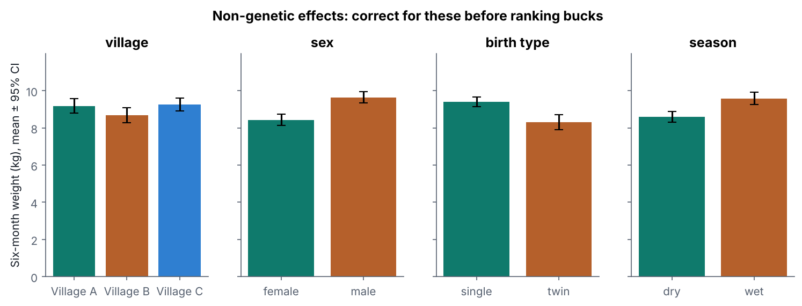
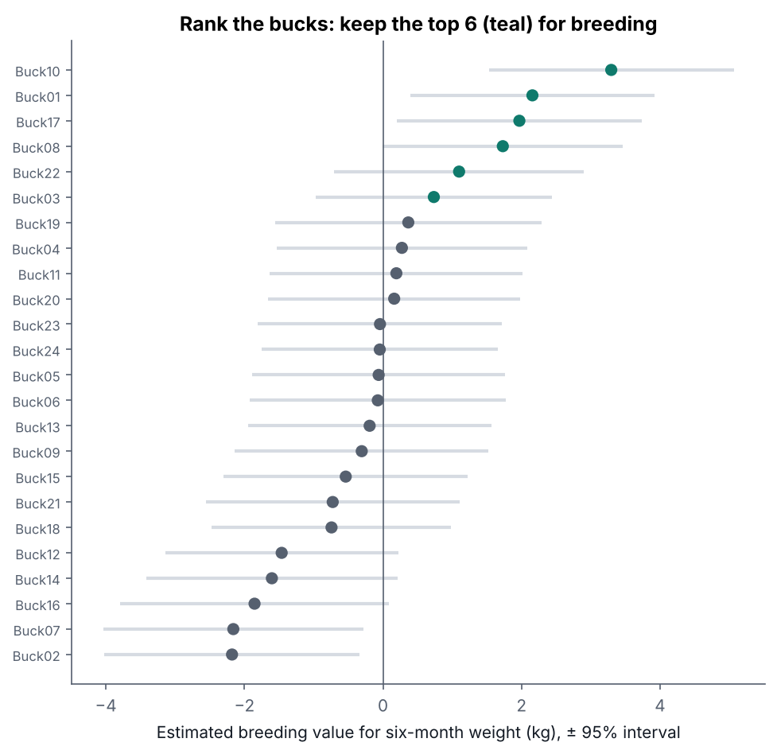
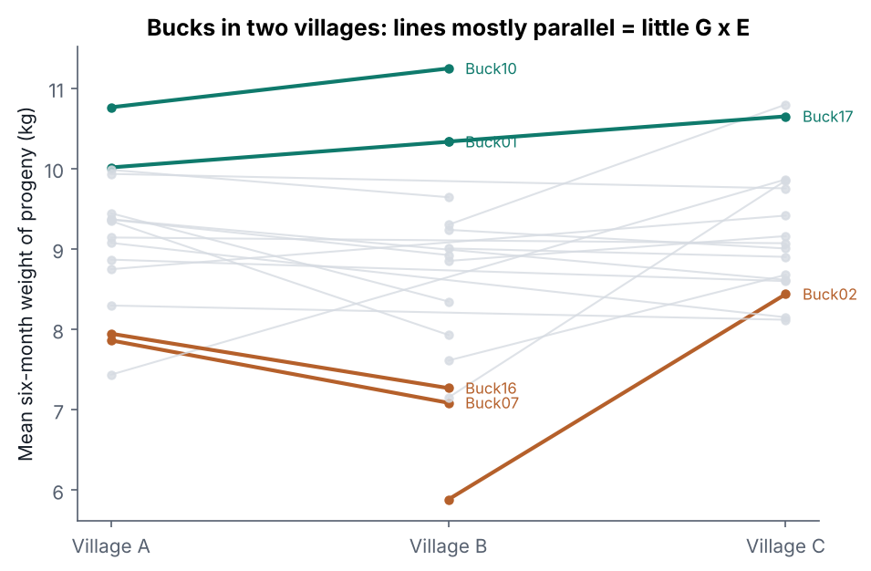
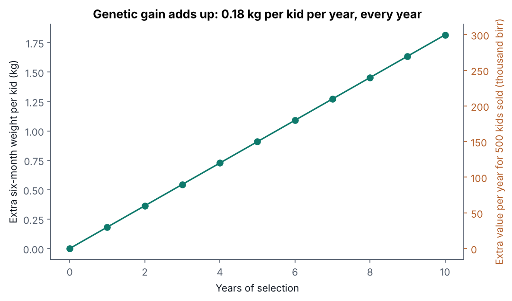
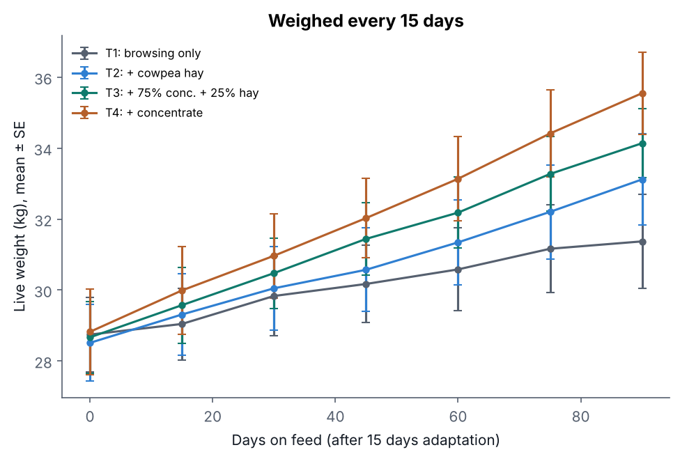
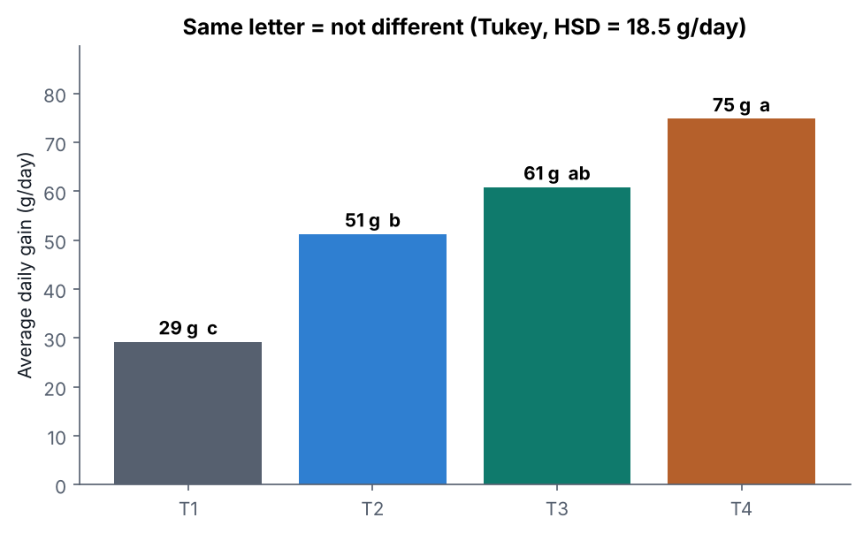
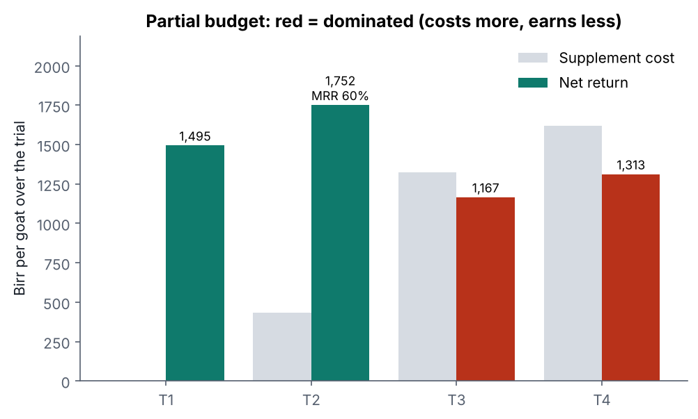

# Module 2 · Goats: breed better bucks, fatten for profit

**ሞጁል 2 · ፍየሎች፦ የተሻሉ አውራ ፍየሎችን ማዳቀልና ለትርፍ ማደለብ**

> **The business questions.** (A) A goat breeders' cooperative must decide *which bucks to keep* each season so that every new generation of kids grows faster. (B) A young entrepreneur buying yearling goats to fatten must decide *which ration earns the most money*, not just which one grows goats fastest. This module answers both with real designs, every ANOVA, and the charts you need to decide.

Both datasets are **simulated for teaching** from published Ethiopian values: community-based breeding programmes (CBBPs) for Abergelle, Central Highland and Woyto-Guji goats, and on-farm fattening trials of castrated yearling goats fed cowpea hay and concentrate. Replace them with your own records and run the same script.

---

## Part A · Community-based breeding

### A1. The design: what to record, and how

Ethiopia's CBBPs keep goats in farmers' flocks. Trained enumerators record every kid, and the community selects bucks together. One season of records from 24 bucks rotated between three villages gave **649 kids** in this example.

| Record | When | Why |
|---|---|---|
| Kid ID, dam ID, sire (buck), village, household | at birth | pedigree: without the sire, no breeding value |
| Sex, birth type (single/twin), dam parity, birth date | at birth | non-genetic effects to correct for |
| Weight at 3 and 6 months | ± 7 days of the target age | six-month weight is the main selection trait for body size |
| Deaths, sales, notes | when they happen | survival and data cleaning |

Studies of Ethiopian CBBPs found that birth weight adds little for genetic improvement and is hard to record accurately in villages, so recording can focus on 3- and 6-month weights. A blank sheet is in [`fieldbooks/cbbp_recording_sheet.csv`](fieldbooks/cbbp_recording_sheet.csv).

**Rotate bucks between villages.** It limits inbreeding and, as a bonus, it lets you test whether a good buck is good everywhere (A4).

### A2. Correct for the environment, then estimate heritability



Least-squares ANOVA, with the buck (sire) entered **after** all fixed effects so it is compared fairly:

| Source | df | SS | MS | F | p |
|---|---|---|---|---|---|
| village | 2 | 41.005 | 20.502 | 3.040 | 0.049 |
| year | 2 | 4.852 | 2.426 | 0.360 | 0.698 |
| season | 1 | 166.591 | 166.591 | 24.701 | <0.001 |
| sex | 1 | 198.867 | 198.867 | 29.486 | <0.001 |
| birth_type | 1 | 169.126 | 169.126 | 25.076 | <0.001 |
| dam_parity | 2 | 27.174 | 13.587 | 2.015 | 0.134 |
| Sire (adjusted) | 23 | 556.838 | 24.210 | 3.590 | <0.001 |
| Residual | 616 | 4154.573 | 6.744 |  |  |

From the sire mean square: σ²(sire) = 0.646, σ²(error) = 6.744, so

```
h² = 4 σ²(sire) / (σ²(sire) + σ²(error)) = 0.35 ± 0.13
```

That is within the 0.15–0.40 range reported for weights in the Abergelle CBBP. It is high enough for selection to work.

### A3. Rank the bucks (BLUP breeding values)



The script solves Henderson's mixed-model equations: fixed effects for village, year, season, sex, birth type and parity, and a random effect for the buck. Bucks with few kids are pulled towards zero, so luck is not mistaken for genetics.

| Buck | EBV (kg) | Accuracy | Kids | SE |
|---|---|---|---|---|
| Buck10 | 3.30 | 0.83 | 28 | 0.90 |
| Buck01 | 2.16 | 0.83 | 29 | 0.90 |
| Buck17 | 1.97 | 0.83 | 28 | 0.90 |
| Buck08 | 1.73 | 0.84 | 31 | 0.88 |
| Buck22 | 1.10 | 0.82 | 26 | 0.92 |
| Buck03 | 0.73 | 0.84 | 33 | 0.87 |
| Buck19 | 0.37 | 0.79 | 21 | 0.98 |
| Buck04 | 0.27 | 0.82 | 27 | 0.92 |

**Decision: keep the top 6 bucks for the next season,** retire the bottom ones from breeding, and sell them for meat. With about 27 kids per buck the accuracy is around 0.82; in this simulation the estimated values correlate 0.82 with the true ones.

### A4. Is a good buck good in every village? (G × E for animals)



| Source | df | SS | MS | F | p |
|---|---|---|---|---|---|
| Sire | 23 | 556.838 | 24.210 | 3.567 | <0.001 |
| Sire x village | 20 | 109.605 | 5.480 | 0.807 | 0.706 |
| Residual | 596 | 4044.968 | 6.787 |  |  |

Buck × village is **not significant (p = 0.71)**. The ranking of bucks holds across villages, so one joint evaluation and one buck exchange plan serve all three villages. If it were significant, you would rank bucks separately for each agro-ecology, exactly like the teff varieties in Module 1.

### A5. What selection is worth



If the best 25% of young bucks are kept on their own six-month weight and does are not selected:

```
gain per year = i × √h² × σa ÷ (L_male + L_female) = 1.27 × 0.59 × 1.45 ÷ (2.5 + 3.5) = 0.18 kg
```

That is in line with the 0.17–0.25 kg per year predicted for the Abergelle CBBP. It is small in one year, but it **accumulates and is permanent**: after 10 years every kid is about 1.8 kg heavier at six months. For a cooperative selling 500 kids a year at 330 birr/kg, that is about **299,775 birr more per year** by year 10, for the cost of recording and a few good bucks.

---

## Part B · Fattening trial: which ration pays?

### B1. The design

| Item | Choice | Why |
|---|---|---|
| Animals | 36 castrated yearling goats, about 28 kg | the class traders buy for fattening |
| Rations | T1 browsing only (control) · T2 + cowpea hay 400 g/day · T3 + 300 g concentrate + 100 g cowpea hay · T4 + concentrate 400 g/day | from home-grown forage to fully bought feed |
| Design | Randomised complete blocks: the 36 goats are sorted by starting weight into 9 blocks of 4, and each block gets all 4 rations at random | heavier goats gain differently; blocking removes that |
| Duration | 15 days adaptation + 90 days, weighed every 15 days in the morning before feeding | standard for Ethiopian fattening trials |
| Records | weights, feed offered and refused, health, prices paid and received | the partial budget needs the money too |

Allocation sheet: [`fieldbooks/fattening_allocation.csv`](fieldbooks/fattening_allocation.csv).

### B2. Growth and ANOVA



RCBD ANOVA for average daily gain:

| Source | df | SS | MS | F | p |
|---|---|---|---|---|---|
| Block | 8 | 882.76 | 110.34 | 0.54 | 0.81 |
| Ration | 3 | 9915.46 | 3305.15 | 16.29 | <0.001 |
| Residual | 24 | 4869.41 | 202.89 |  |  |

ANCOVA with starting weight as a covariate:

| Source | df | SS | MS | F | p |
|---|---|---|---|---|---|
| Block | 8 | 882.76 | 110.34 | 0.52 | 0.83 |
| Initial weight (covariate) | 1 | 0.02 | 0.02 | 0.00 | 0.99 |
| Ration (adjusted) | 3 | 9944.95 | 3314.98 | 15.75 | <0.001 |
| Residual | 23 | 4839.89 | 210.43 |  |  |

The covariate adds nothing here (p = 0.99) because **blocking by starting weight already did its job**. That is why you block.



| Ration | Start kg | Final kg | ADG g/day | SD | Tukey |
|---|---|---|---|---|---|
| T1: browsing only | 28.7 | 31.4 | 29.2 | 16.5 | c |
| T2: + cowpea hay | 28.5 | 33.1 | 51.2 | 11.4 | b |
| T3: + 75% conc. + 25% hay | 28.7 | 34.1 | 60.8 | 10.4 | ab |
| T4: + concentrate | 28.8 | 35.6 | 74.8 | 14.4 | a |

### B3. The money: partial budget

Only costs and returns that differ between rations are counted (CIMMYT partial-budget method). Example prices: buy 330 birr/kg live, sell 350 birr/kg, concentrate 45 birr/kg, cowpea hay 12 birr/kg.



| Ration | Purchase | Sale | Supplement cost | Net return | Dominated | MRR % |
|---|---|---|---|---|---|---|
| T1: browsing only | 9,486 | 10,981 | 0 | 1,495 | no |  |
| T2: + cowpea hay | 9,409 | 11,593 | 432 | 1,752 | no | 60 |
| T3: + 75% conc. + 25% hay | 9,460 | 11,950 | 1,323 | 1,167 | yes |  |
| T4: + concentrate | 9,511 | 12,444 | 1,620 | 1,313 | yes |  |

**Decision:** at these prices **T2 (cowpea hay) earns the most per goat**. The concentrate rations grow goats faster but cost more than the extra weight is worth, so they are *dominated*. The marginal rate of return (MRR) of moving from T1 to T2 is 60%.

**The number that changes the decision:** T4 beats T2 only if concentrate costs less than **33 birr/kg**. Check the price before you buy feed; this one line of arithmetic decides the business.

### B4. From trial to business

* **Batch plan:** 20 goats per 105-day batch, 3 batches a year. At T2 that is about 105,127 birr net a year before labour and housing, and it needs about 2.2 t of cowpea hay a year (20 goats × 0.4 kg × 90 days × 3 batches).
* **Grow the feed:** under-sowing cowpea is one way to produce hay on the farm, and it turns a bought input into your own margin.
* **Sell at the right time:** holidays raise goat prices. Plan the batch so day 90 falls before them.
* **Join the CBBP:** buy yearlings from improved bucks (Part A) and the fattening gain starts from a heavier, faster-growing animal.

---

## Run it yourself

```bash
pip install numpy pandas scipy matplotlib
python run.py
```

Change the prices, rations and genetic parameters at the top of `run.py`. To use your own records, keep the column names of the CSV files in `data/` and replace the simulation lines with `pd.read_csv(...)`.

---

## በአማርኛ አጭር ማጠቃለያ

* **ማዳቀል፦** ከ6 ወር ክብደት የተገኘው የዘር ውርስ መጠን (h²) 0.35 ነው፤ ምርጥ 6 አውራ ፍየሎችን ይያዙ፤ አውራ × መንደር መስተጋብር የለም፤ በየዓመቱ ለእያንዳንዱ ግልገል 0.18 ኪግ ይጨመራል፣ ይህም ይከማቻል።
* **ማደለብ፦** ሙሉ የፋብሪካ መኖ (T4) ፈጣን ዕድገት ቢሰጥም በዚህ ዋጋ በጣም ትርፋማው በአካባቢ የሚመረተው የላም አተር ድርቆሽ (T2) ነው።
* **ወሳኙ ቁጥር፦** የፋብሪካ መኖ ከ33 ብር/ኪግ በታች ካልሆነ T2 ያሸንፋል።

*Data in this module are simulated for teaching from published Ethiopian values:*
*[Abergelle CBBP evaluation, Hawassa University](https://etd.hu.edu.et/handle/123456789/640) (six-month weight, heritabilities) ·
[ZPLAN breeding schemes for Abergelle and Western Lowland goats](https://journal.uni-mate.hu/index.php/aak/article/download/2100/2616/2327) (σa 1.45, σp 2.74) ·
[Genetic parameters and breeding plans for CBBP goats](https://agris.fao.org/search/en/records/64746b442d3f560f80a89575) (predicted annual gain) ·
[Birth weight in village breeding programmes, LRRD](https://lrrd.org/lrrd28/8/teme28135.html) ·
[On-farm goat fattening with cowpea hay and concentrate, Tropentag 2021](https://www.tropentag.de/2021/abstracts/links/Abebe_1Z34yRR6.pdf) (36 yearlings, 28.2 kg) ·
[ICARDA goat feeding demonstration](https://mel.cgiar.org/reporting/download/hash/YNtSqdaW) (400 g/day supplement, partial budget, MRR) ·
[Goat supplementation trial with 90-day feeding and fortnightly weighing](https://springerlink.bibliotecabuap.elogim.com/content/pdf/10.1007/s11250-017-1477-3.pdf) ·
[Partial budget of goat feeding systems, LRRD](https://lrrd.org/lrrd17/6/lege17066.htm).*
