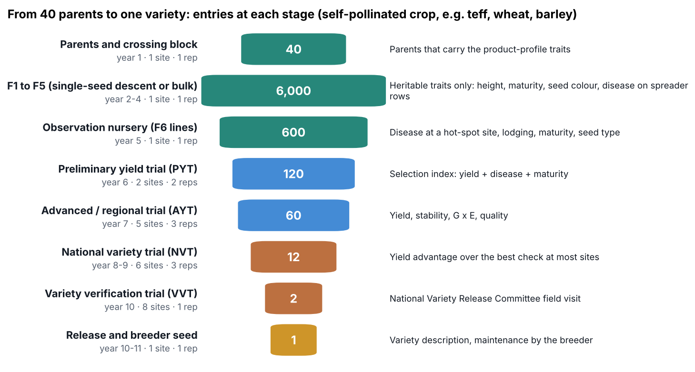
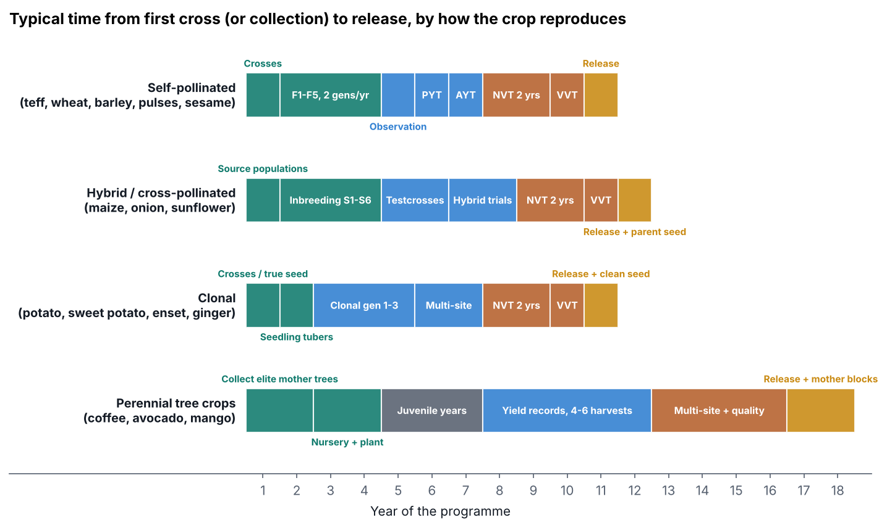
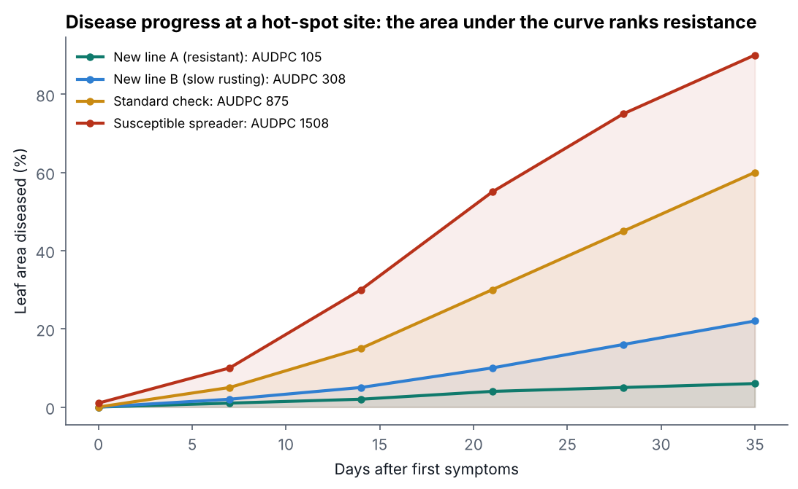
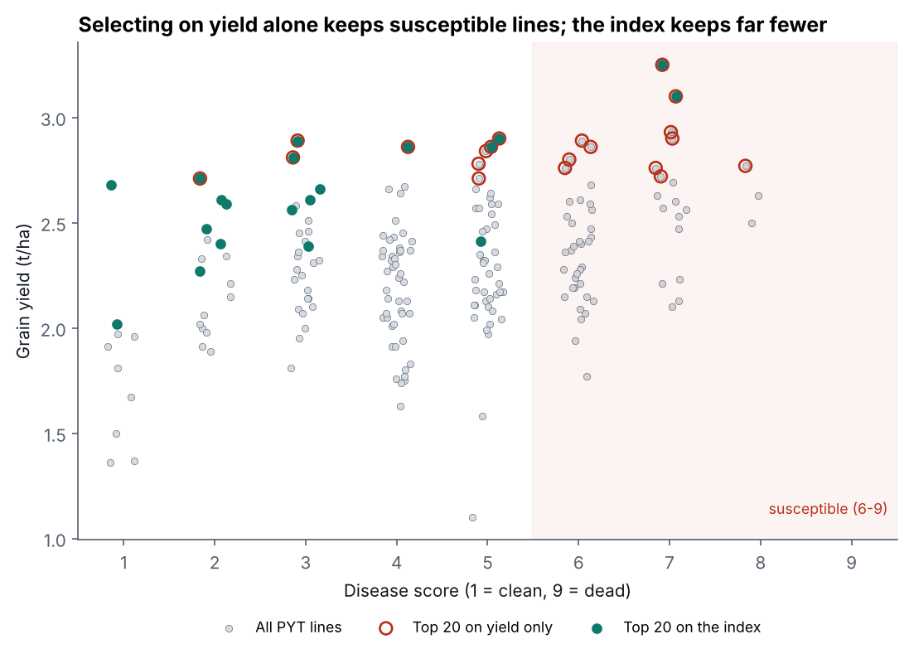
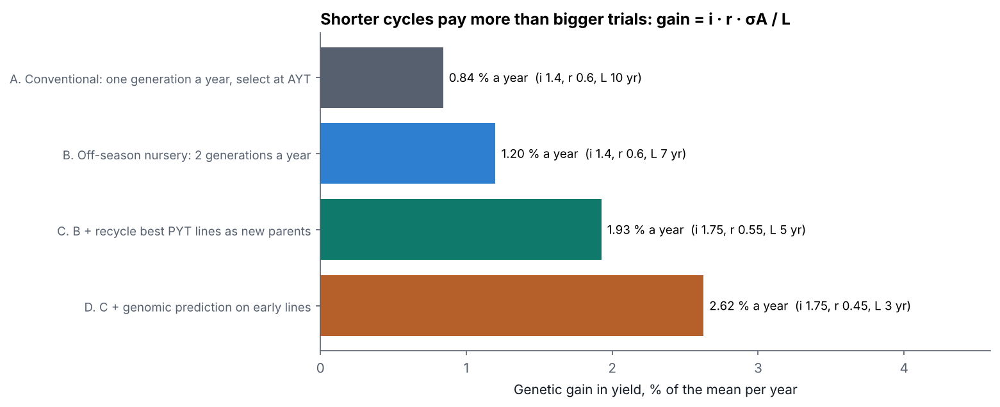
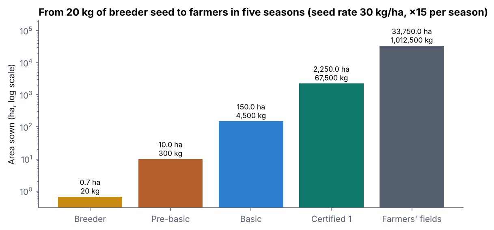

# Module 3 · The variety development plan: from parents to farmers' fields

**ሞጁል 3 · የዝርያ ማሻሻያ ዕቅድ፦ ከወላጅ ዝርያዎች እስከ አርሶ አደሩ ማሳ**

> **The business question.** A variety is a product. Farmers buy it only if it beats what they grow, on their land, against the diseases and weather they face, and the grain sells. This module is the plan a breeding programme or a seed company follows to get there: what to breed for, how many lines to test where and when, how to screen for disease and climate stress, how to combine yield with resistance, how fast you gain, and how seed reaches farmers.

Use it with the **[crop advisor](../../crops/)**, which holds profiles of 60 Ethiopian crops (cereals, pulses, oilseeds, roots and tubers, vegetables, fruits, spices, coffee) and recommends registered varieties for an altitude, a rainfall and a priority. Module 1 is the multi-location stage of this plan in full detail.

Numbers in the worked examples (disease scores, the 200-line trial, gains) are **simulated or illustrative for teaching**; the stages, designs and release steps follow Ethiopian practice as published in variety registration papers.

---

## 1. Start from a product profile, not from a cross

Before making a single cross, write down what the new variety must do better than the best variety farmers already grow. A product profile has four parts:

1. **Where:** the target environments (altitude, rainfall, soil, season). In Ethiopia altitude is the first sorting variable: the same crop faces different diseases at 1,800 m and at 2,600 m.
2. **What kills yield there:** the two or three diseases, pests and climate stresses that cost farmers the most.
3. **What the market pays for:** seed colour (very white teff), grain size (faba bean), pungency and colour (berbere pepper), cup quality (coffee), processing quality (potato chips, malt barley).
4. **The check to beat:** the most popular released variety in that area. A new variety must beat it on yield *and* not lose on any trait farmers care about.

Product profiles for some of Ethiopia's major crops (full list in the crop advisor and in [`catalogue/crops.csv`](https://github.com/Muler-21/breed-to-business/blob/main/catalogue/crops.csv)):

| Crop | Target environment | Diseases and pests to beat | Product profile: desired traits |
|---|---|---|---|
| Teff | 1,500–2,800 m; 700–1,300 mm; vertisols and red soils | Lodging (the main yield loss); shoot fly; red teff worm; rust (minor) | Lodging resistance (semi-dwarf, stronger culm); grain yield; white or very white seed for market; early maturity for short seasons; drought tolerance |
| Bread wheat | 1,800–3,000 m rain-fed; irrigated lowlands (Awash, Rift Valley) in the dry season | Stem rust (Ug99 lineage); yellow (stripe) rust, which hit about 600,000 ha in 2010; leaf rust; Septoria | Durable rust resistance (adult-plant genes, not single major genes); yield stability; heat tolerance for lowland irrigation; bread-making quality (protein, gluten) |
| Maize | 500–2,400 m; 600–1,500 mm; three ecologies: highland, mid-altitude, lowland moisture-stress | Turcicum leaf blight; grey leaf spot; common rust; maize lethal necrosis; maize streak virus; stalk borers; fall armyworm | Hybrid yield; disease resistance by ecology; drought and low-N tolerance; nutritional quality (quality-protein and provitamin-A maize) |
| Faba bean | 1,800–3,000 m; cool highlands | Chocolate spot (Botrytis fabae); faba bean gall (Olpidium viciae, newly established); rust; Ascochyta blight; root rots; Orobanche (broomrape) | Grain yield; large seed size; resistance to chocolate spot and gall; Orobanche resistance; waterlogging and acidity tolerance |
| Potato | 1,800–3,000 m; two seasons (belg and meher) | Late blight; bacterial wilt; viruses (PLRV, PVY); potato tuber moth | Late blight resistance; bacterial wilt tolerance; yield; processing quality (chips); storability; clean seed |
| Hot and red pepper (berbere) | 1,000–2,000 m; Mareko, Bako and many highland zones | Phytophthora blight; Fusarium wilt; viruses (CMV, PVY); powdery mildew; bacterial spot (27 pepper diseases recorded) | Deep red colour (ASTA value) and pungency for berbere and oleoresin export; disease resistance; yield |
| Ginger | Humid south-west and south (Tepi, Wolaita, Kambata) | Bacterial wilt (Ralstonia solanacearum) devastated production; rhizome rot | Wilt-free clean rhizomes; yield; pungency and oleoresin for export |
| Coffee (arabica) | 1,000–2,300 m; south-west forests, Sidama, Gedeo, Guji, Harar | Coffee berry disease; coffee wilt disease (no commercial wilt-resistant variety yet); coffee leaf rust (rising at lower altitudes) | Berry disease resistance; wilt and leaf rust resistance; cup quality (specialty profiles); yield; compact canopy |

---

## 2. The pipeline for a self-pollinated crop

Teff, wheat, barley, rice, sorghum, most pulses, sesame, linseed and tomato fix their genes by selfing, so a selected line breeds true. This is the standard Ethiopian path, from crosses to the National Variety Release Committee (NVRC):

| Stage | Year | Entries | Sites | Reps | Plots | Design | Select on |
|---|---|---|---|---|---|---|---|
| Parents and crossing block | 1 | 40 | 1 | 1 | 40 | Unreplicated crossing block | Parents that carry the product-profile traits |
| F1 to F5 (single-seed descent or bulk) | 2-4 | 6,000 | 1 | 1 | 6,000 | Bulk plots; 2 generations a year with an irrigated off-season | Heritable traits only: height, maturity, seed colour, disease on spreader rows |
| Observation nursery (F6 lines) | 5 | 600 | 1 | 1 | 600 | Augmented design: unreplicated lines + repeated checks | Disease at a hot-spot site, lodging, maturity, seed type |
| Preliminary yield trial (PYT) | 6 | 120 | 2 | 2 | 480 | Alpha-lattice, 2 reps | Selection index: yield + disease + maturity |
| Advanced / regional trial (AYT) | 7 | 60 | 5 | 3 | 900 | Alpha-lattice, 3 reps (Module 1) | Yield, stability, G x E, quality |
| National variety trial (NVT) | 8-9 | 12 | 6 | 3 | 216 | RCBD, 3-4 reps, 2 years, standard + local checks | Yield advantage over the best check at most sites |
| Variety verification trial (VVT) | 10 | 2 | 8 | 1 | 16 | Large plots on station and farms with standard and local checks | National Variety Release Committee field visit |
| Release and breeder seed | 10-11 | 1 | 1 | 1 | 1 | Registration; breeder seed plots | Variety description, maintenance by the breeder |

What the published release papers show:

- **Felagot teff** came from a cross between Quncho and the farmers' cultivar Gea Lammie, inbred for at least seven generations; 12 genotypes were then tested over two years at six teff locations, and the NVRC released it in March 2017.
- **Pawe-2 upland rice** was tested in a national variety trial at five sites for two years in an RCBD with three replications, then in verification trials, before the NVRC approved it.
- **Shafeta orange-fleshed sweet potato** went through a national variety trial at three sites over two years, then a variety verification trial against two standard checks.
- **Kale K14 and K18** (released May 2026) went through characterisation, preliminary screening, multi-location trials, the NVT and verification at eight sites; breeder seed multiplication then started at Kulumsa.

**Rules that save years:**

- Select only highly heritable traits in early generations (height, maturity, seed colour, disease on spreader rows). Do not select for yield on single unreplicated plots: heritability there is too low.
- Use an irrigated off-season site to grow two generations a year.
- Put every stage from the PYT on in an **alpha-lattice** (Module 1). Fields in the highlands are not uniform.
- Always include the **standard check** (best released variety for the area) and a **local check** (farmers' variety). The release committee compares against both.

---

## 3. Plans by how the crop reproduces

| Reproduction | Crops | How you make a variety | Typical years to release | What to watch |
|---|---|---|---|---|
| **Self-pollinated** | Teff, wheat, barley, rice, sorghum, faba bean*, field pea, chickpea, lentil, haricot bean, sesame, linseed, tomato, black cumin, fenugreek | Cross, then inbreed to pure lines (single-seed descent, bulk or pedigree); test lines | 8–11 | Keep diversity: cross landraces into elite lines |
| **Cross-pollinated / hybrid** | Maize, onion, noug, sunflower, head cabbage, carrot, coriander | Hybrids: develop inbred lines in heterotic groups, test their crosses, sell F1 seed every year. Or population improvement (recurrent selection) for open-pollinated and synthetic varieties | 9–12 | Hybrid seed must be bought each season: a business, but farmers need the cash and a seed company to deliver |
| **Clonal** | Potato, sweet potato, enset, taro, cassava, ginger, turmeric, garlic, shallot, banana, sugarcane | Cross (or collect), then every good seedling is a clone: no inbreeding needed. Test clones over generations and sites | 8–11 | Viruses and bacterial wilt travel in planting material. Clean seed (tissue culture, mini-tubers) is half of the variety |
| **Perennial tree crops** | Coffee, avocado, mango, citrus, apple | Select elite mother trees (from forests, gardens, introductions); test progenies or grafted clones over 4–6 harvests; propagate by seed lines, grafting or budding | 15–20 | Each cycle is long, so start from the best existing trees and use rootstocks for soil diseases |

\* Faba bean is partly cross-pollinated by bees: isolate selection plots or use bags, or lines drift.

---

## 4. Breeding for disease resistance

**Where to screen.** Screen where the disease is every year: a *hot-spot* site, with rows of a very susceptible variety (spreader rows) around and through the trial so every line is exposed. For diseases that are not reliable in the field, inoculate. Wheat rust screening in Ethiopia uses hot-spot sites in the Arsi and Bale highlands; faba bean chocolate spot and gall need wet highland sites.

**How to score.** Score the same plots 4–6 times through the epidemic, as % leaf area diseased or on a 1–9 scale, and compute the **area under the disease progress curve (AUDPC)**. AUDPC separates a line that stays clean from one that only starts late.

| Entry | Final severity % | AUDPC (%-days) | Relative AUDPC % | Reaction |
|---|---|---|---|---|
| New line A (resistant) | 6 | 105 | 7 | Resistant |
| New line B (slow rusting) | 22 | 308 | 20 | Moderately resistant (slow rusting) |
| Standard check | 60 | 875 | 58 | Susceptible |
| Susceptible spreader | 90 | 1508 | 100 | Very susceptible |

AUDPC = Σ (sᵢ + sᵢ₊₁)/2 × (tᵢ₊₁ − tᵢ). The *relative* AUDPC (as % of the susceptible spreader) lets you compare sites and years. Analyse it with the same ANOVA as yield (log-transform if variances differ).

**How to make resistance last.**

- **Avoid relying on one major gene.** A single major gene (all-or-nothing resistance) is often defeated by a new pathogen race within a few years. The 2010 yellow rust epidemic in Ethiopia hit about 600,000 ha of wheat; the varieties Kakaba and Danda'a stayed resistant and were then fast-tracked to farmers.
- **Prefer slow-rusting, adult-plant resistance** (line B above): several minor genes that slow the epidemic. It is harder to defeat.
- **Pyramid** two or three resistance genes in one variety, using markers where they exist.
- **Backcross to fix a defect.** When a popular variety has one weakness, backcross a resistance source into it and keep everything else. Faba bean breeders used this "defect removal" approach to add chocolate spot resistance.
- **Deploy diverse varieties** across an area, and keep monitoring races with trap nurseries.
- **Clean planting material** for clonal crops: for ginger bacterial wilt, enset bacterial wilt, potato viruses and late blight, a resistant variety on infected seed still fails.

---

## 5. Breeding for climate adaptation

1. **Define the target population of environments.** Map where the crop is grown by altitude, rainfall, season length and soil (vertisols, acid soils). Group them into a few *mega-environments*.
2. **Test in the right places.** Pick trial sites that represent each mega-environment, including the stressed end (Alem Tena in Module 1). Use managed stress where nature is unreliable: late sowing or rain-out shelters for terminal drought, acid-soil sites (western Oromia, Awi) for aluminium tolerance, undrained vertisols for waterlogging.
3. **Match maturity to the season.** In dry, short-season areas an early variety *escapes* terminal drought. In Module 1, TF47 matures about 11 days earlier than Quncho and still yields well in high-potential sites.
4. **Measure stability and decide broad or specific adaptation.** Run the multi-location analysis (combined ANOVA, AMMI, GGE which-won-where, Eberhart–Russell) from Module 1. Release a widely adapted variety where one is stable everywhere, and separate varieties for separate mega-environments where the which-won-where plot splits them.
5. **Plan for the next 20 years, not the last 20.** Climate warming pushes diseases uphill (coffee leaf rust at lower altitudes, wheat rusts) and shortens seasons in the lowlands. Test today's lines at sites that are already as warm as the target area will be.

---

## 6. Combining yield, disease and maturity: the selection index

A breeder rarely gets one trait at a time. In this simulated preliminary yield trial (200 lines, 2 sites), taller and later lines yield more but also carry more disease. Selecting the top 20 on yield alone keeps the susceptible ones.

A simple index standardises each trait and adds them with economic weights: **I = 1.0 × z(yield) − 0.7 × z(disease) − 0.4 × z(days to maturity)**. Here the weights say that a one-standard-deviation rise in disease costs 70 % as much as a one-SD gain in yield.

| Group | Yield t/ha | Disease score 1-9 | Days to maturity | Lines scoring 6 or worse |
|---|---|---|---|---|
| All 200 lines | 2.30 | 4.43 | 94.85 | 55 |
| Top 20 on yield only | 2.85 | 5.55 | 101.05 | 11 |
| Top 20 on the index | 2.65 | 3.25 | 96.90 | 2 |

The yield-only top 20 included **11 lines scoring 6 or worse** for disease; the index top 20 included **2**. The index gave up **0.20 t/ha** of average yield in this trial to buy resistance and **4 days** earlier maturity: yield that the susceptible lines would lose in an epidemic year anyway.

Set the weights with farmers and buyers: how much yield would they give up for a variety that does not need fungicide, or that is ready two weeks earlier?

---

## 7. How fast you gain: shorten the cycle

The breeder's equation gives genetic gain per year: **ΔG = i × r × σA / L**, where *i* is selection intensity, *r* the accuracy of selection, *σA* the additive genetic standard deviation, and *L* the years from making a cross to using its best offspring as parents.

| Programme | i | r | L (years) | Gain % per year | After 15 years t/ha |
|---|---|---|---|---|---|
| A. Conventional: one generation a year, select at AYT | 1.40 | 0.60 | 10 | 0.84 | 2.25 |
| B. Off-season nursery: 2 generations a year | 1.40 | 0.60 | 7 | 1.20 | 2.36 |
| C. B + recycle best PYT lines as new parents | 1.75 | 0.55 | 5 | 1.93 | 2.58 |
| D. C + genomic prediction on early lines | 1.75 | 0.45 | 3 | 2.62 | 2.79 |

With the same field budget, programme D gains **2.62 %** a year against **0.84 %** for the conventional one: **3.1 times faster**, mostly because L falls from 10 to 3 years. The cheap first step is the off-season nursery and recycling the best PYT lines as parents straight away; genomic prediction comes later, once a programme has genotyped trials to train on.

---

## 8. Release, seed and the business

1. **NVT (2 years, multi-location, standard + local checks)** → **VVT** on station and on farms → **NVRC field evaluation and release** → entry in the national Crop Variety Register (see the [catalogue](../../catalogue/)).
2. **Seed classes:** breeder seed (kept by the breeding centre) → pre-basic → basic → certified seed sold to farmers. Each class is a season of multiplication under inspection.

| Season | Class | Seed sown kg | Area ha | Harvest kg |
|---|---|---|---|---|
| 1 | Breeder | 20.0 | 0.7 | 300.0 |
| 2 | Pre-basic | 300.0 | 10.0 | 4,500.0 |
| 3 | Basic | 4,500.0 | 150.0 | 67,500.0 |
| 4 | Certified 1 | 67,500.0 | 2,250.0 | 1,012,500.0 |
| 5 | Farmers' fields | 1,012,500.0 | 33,750.0 | 15,187,500.0 |

Twenty kilograms of breeder teff seed can plant about **33,750 ha** of farmers' fields in the fifth season, *if* every class is multiplied on time. The usual bottleneck in Ethiopia is not the breeding but this chain: many released varieties never reach farmers at scale.

**Where the entrepreneur fits:**

- **Seed company or seed cooperative:** license a released variety (or a public one), multiply basic → certified seed, and sell it. Hybrids (maize, vegetables) mean repeat customers every season.
- **Clean planting material:** tissue-cultured potato mini-tubers, ginger and turmeric rhizomes, banana plantlets, grafted avocado and mango seedlings. Disease-free material is a product farmers will pay for.
- **Contract breeding and trials:** run multi-location trials (Module 1) for seed companies and NGOs.
- **Market varieties:** malt barley for breweries, export white haricot beans, high-colour pepper for oleoresin, specialty coffee. Here the buyer often pays for the seed system.

---

## በአማርኛ አጭር ማጠቃለያ

- ዝርያ ምርት ነው። አርሶ አደሩ የሚገዛው በማሳው ላይ፣ በሽታውንና የአየር ንብረቱን ተቋቁሞ ካለው ዝርያ በላይ ሲያመርትና ምርቱ ሲሸጥ ብቻ ነው።
- **የምርት መገለጫ (product profile)** ይጻፉ፦ የት (ከፍታ፣ ዝናብ፣ አፈር)፣ ምርትን የሚቀንሱ በሽታዎችና ተባዮች፣ ገበያው የሚፈልገው ባሕርይ፣ እና ሊበለጥ የሚገባው ደረጃ ዝርያ።
- ራሳቸውን የሚያዳቅሉ ሰብሎች (ጤፍ፣ ስንዴ፣ ገብስ፣ ጥራጥሬዎች)፦ ማዳቀል → F1–F5 → የምልከታ ማሳ → PYT → AYT → ብሔራዊ የዝርያ ሙከራ (2 ዓመት፣ በብዙ ቦታዎች) → የማረጋገጫ ሙከራ (VVT) → በብሔራዊ የዝርያ አጽዳቂ ኮሚቴ መልቀቅ። ከ8–11 ዓመት ይወስዳል።
- በቆሎና ሽንኩርት (ዲቃላ)፣ ድንችና ዝንጅብል (በክሎን የሚራቡ)፣ ቡናና አቮካዶ (ቋሚ ተክሎች) የተለያየ ዕቅድ አላቸው። ቋሚ ተክሎች 15–20 ዓመት ይፈጃሉ።
- **በሽታን መቋቋም፦** በሽታው ሁልጊዜ በሚገኝበት ቦታ ይሞክሩ፣ በተደጋጋሚ ይመዝግቡ፣ AUDPC ያስሉ። በአንድ ዋና ዘረመል ብቻ አይመኩ፤ ቀስ ብሎ የሚታመም (slow rusting) መቋቋምን ይምረጡ። በ2010 ቢጫ ዋግ ወደ 600,000 ሄክታር ስንዴ አጥቅቷል።
- **የአየር ንብረት መላመድ፦** የሙከራ ቦታዎች የደረቁትንና አሲዳማ አፈር ያላቸውን ቦታዎች ያካትቱ፤ ቀድመው የሚደርሱ ዝርያዎች ድርቅን ያመልጣሉ፤ የመረጋጋት ትንተና (ሞጁል 1) ይጠቀሙ።
- **የምርጫ መለኪያ (selection index)፦** ምርትን ብቻ መምረጥ በሽታ የሚይዛቸውን መስመሮች ያስቀራል፤ ምርት፣ በሽታና የመድረሻ ቀንን አንድ ላይ ይመዝኑ።
- **የዘረመል ዕድገት = i × r × σA / L።** ዑደቱን ማሳጠር (በዓመት ሁለት ትውልድ፣ ጥሩ መስመሮችን ቶሎ ወላጅ ማድረግ) ከትልቅ ሙከራ በላይ ይጠቅማል።
- **ዘር፦** የአርቢ ዘር → ቅድመ-መሠረታዊ → መሠረታዊ → የተረጋገጠ ዘር። የዘር ኩባንያ፣ ንጹሕ የመትከያ ቁሳቁስ (ቲሹ ካልቸር) እና የኮንትራት ሙከራ የሥራ ፈጠራ ዕድሎች ናቸው።

## Sources

- Felagot tef release: [Ethiop. J. Agric. Sci.](https://ajol.info/index.php/ejas/article/view/201108)
- Pawe-2 rice release: [East African Journal of Sciences](https://www.eajs.haramayajournals.org/index.php/eajs/article/view/1857)
- Shafeta sweet potato release: [Ethiop. J. Agric. Sci. 34(1)](https://ajol.info/index.php/ejas/article/view/276022/260501)
- Kale K14 and K18 release, 2026: [FreshPlaza](https://www.freshplaza.com/africa/article/9845533/ethiopia-releases-first-locally-adapted-kale-varieties/)
- Wheat rust epidemic and fast-track release: [ICARDA](https://mel.cgiar.org/reporting/download/hash/2uerl9Gt); [CIMMYT](https://cimmyt.org/?p=19901)
- Faba bean backcross defect removal: [IJGPB](https://isgpb.org/journal/index.php/IJGPB/article/download/198/1979)
- Variety register size and seed uptake: [Trends of crop variety release in Ethiopia](https://ajol.info/index.php/ejcs/article/view/267222/252133)
- All crop profile sources: [`catalogue/sources.csv`](https://github.com/Muler-21/breed-to-business/blob/main/catalogue/sources.csv)

**Reproduce:** `python modules/03-variety-development-plan/run.py` writes the figures, the tables in [`tables/`](tables/) and this guide.
