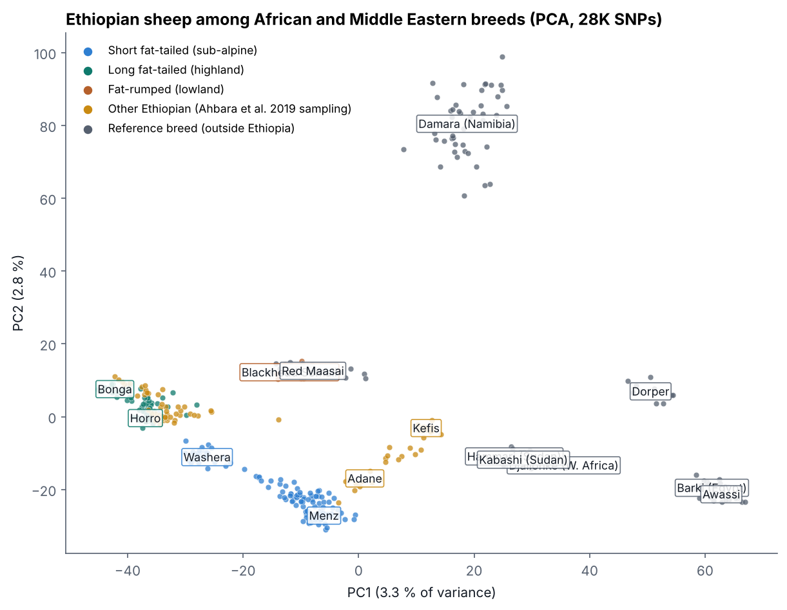
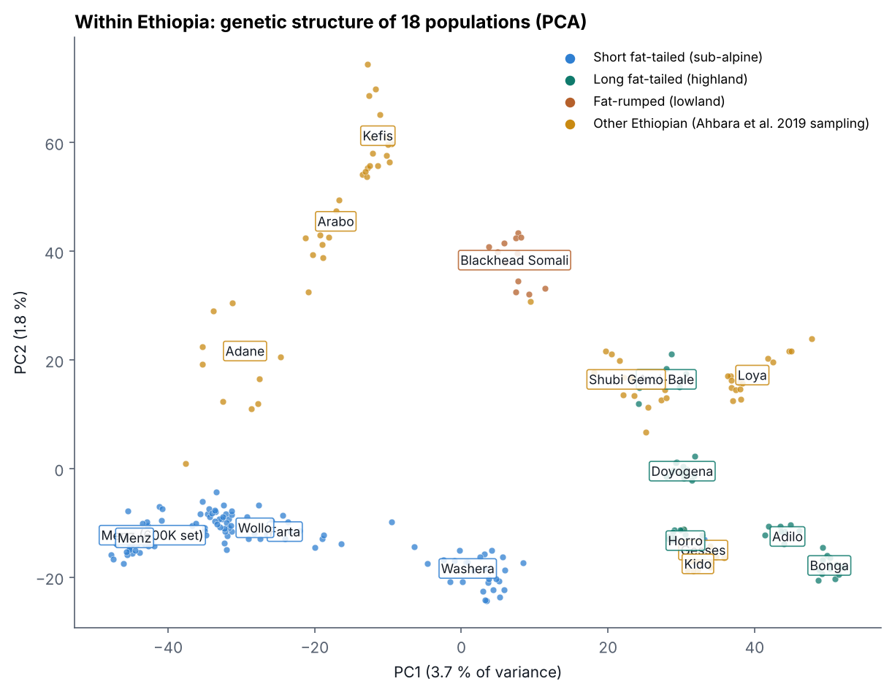
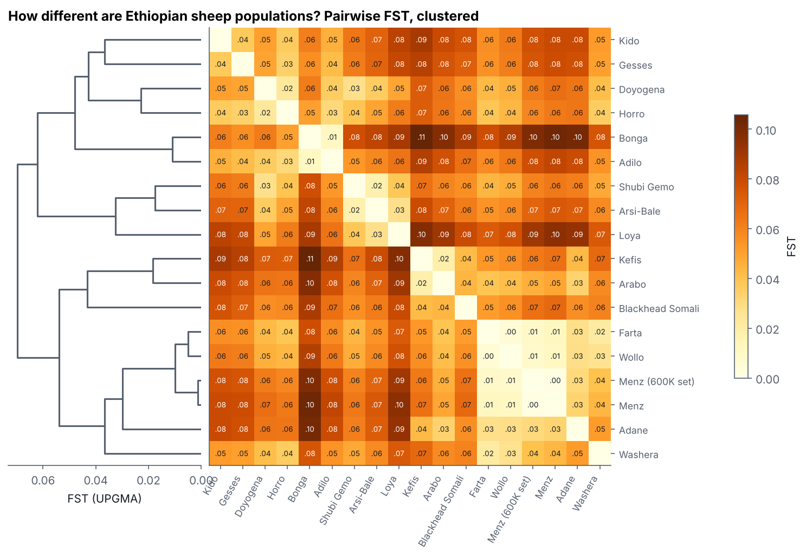
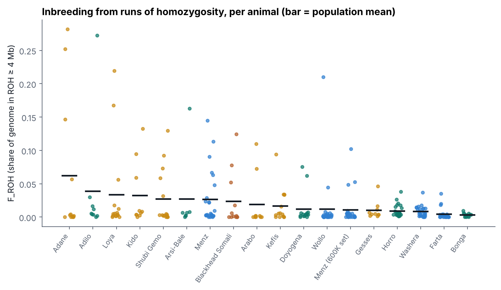
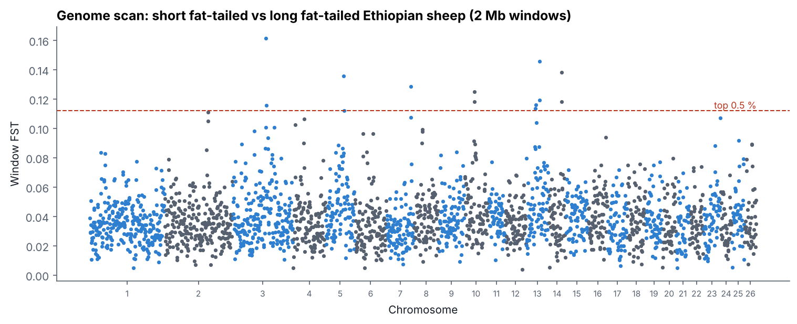
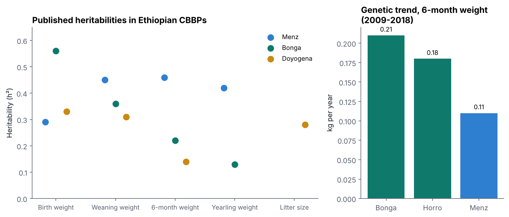
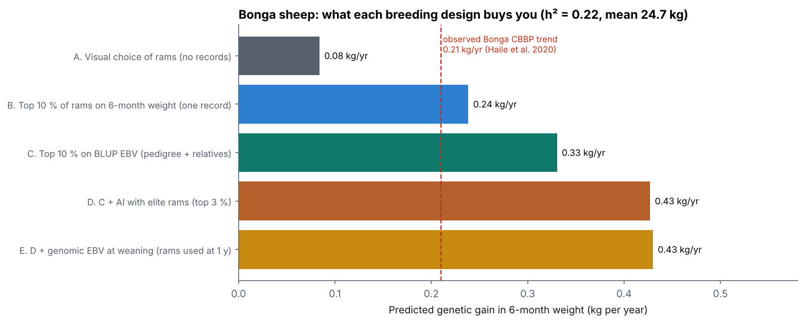
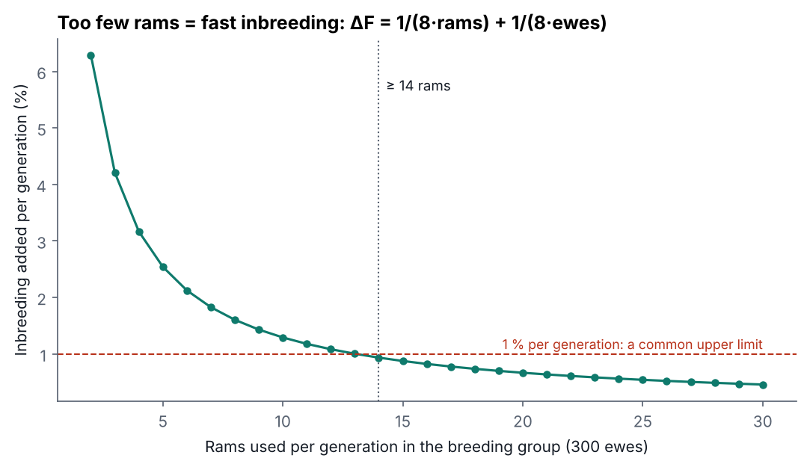
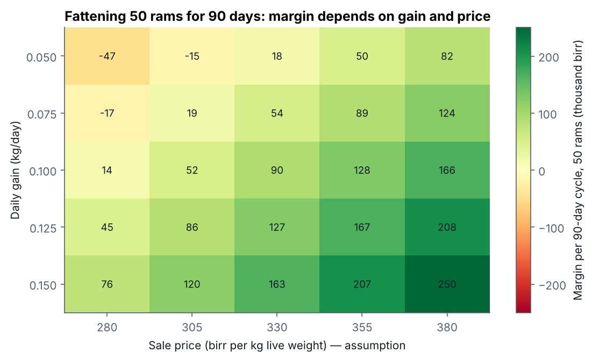

# Module 4 · Sheep: from the ground to a company

**ሞጁል 4 · በግ፦ ከመሬት እስከ ኩባንያ**

> **The business question.** Ethiopia keeps about 42.9 million sheep, almost all of them indigenous. How do you turn that genetic resource into more meat, more income and a business: knowing your breed down to its DNA, recording, selecting better rams, keeping animals alive, and selling into domestic, export and leather markets?

This module goes step by step, from the flock on the ground to a company. Every number is labelled:

- **Published:** from cited Ethiopian studies.
- **Real data:** our own analysis of public SNP genotypes of 292 Ethiopian sheep, run in this repository.
- **Assumption:** a planning value you must replace with your own, such as prices or a variability not reported in the papers.

The breed list with synonyms is in the [catalogue](../../catalogue/). Module 2 covers the same breeding logic for goats.

---

## Step 0 · The resource and the market

| Fact | Value | Source |
|---|---|---|
| Sheep in Ethiopia (2021) | about 42.9 million | CSA 2021, via [Asmare et al. / MEL](https://repo.mel.cgiar.org/signposting/describedby/6e7ce287-c5c7-45b9-9dc1-02ce046ca4c1) |
| Share of indigenous sheep | 99.56 % | DAD-IS 2021, same source |
| Growth of the sheep population, 2011–2020 | about 4.6 % a year | [Frontiers Vet. Sci. 2022](https://frontiersin.org/articles/10.3389/fvets.2022.972887/pdf) |
| Small ruminants' share of meat export revenue, 2018/19 | about 86 % of USD 93 million | same |
| Traditional sheep populations | 14, in four tail types: short fat-tailed, long fat-tailed, fat-rumped, thin-tailed | Gizaw 2008, via [Ahbara et al. 2019](https://www.frontiersin.org/journals/genetics/articles/10.3389/fgene.2018.00699/pdf) |
| Sheep leather | National brand "Ethiopian Highland Leather"; light, thin, soft yet strong, used for golf and fashion gloves | [JICA 2021](https://www.jica.go.jp/english/overseas/ethiopia/information/topics/2021/210831.html) |

**What this means for a business:** the animals are already there and adapted. The gaps are in growth rate, survival, market weight and quality, and in getting improved rams to farmers. Each step below closes one gap.

---

## Step 1 · Know your breed down to its DNA (real data)

We analysed the public genotype set of Da Silva et al. (2024, *Animal Genetics*, CC BY 4.0). It covers 2,818 sheep at 28,210 SNPs, with 18 Ethiopian populations genotyped in earlier studies. We added reference breeds from Sudan, Kenya, Egypt, West and southern Africa, and the Awassi and Dorper used for crossbreeding in Ethiopia. After quality control (SNP call rate ≥ 95 %, animal call rate ≥ 90 %, minor allele frequency ≥ 1 %), **475 animals and 28,206 SNPs** remained.

The code is in [`genomics/analyse.py`](genomics/analyse.py) (pure Python) and [`genomics/plink_steps.sh`](genomics/plink_steps.sh) (the same steps in PLINK, for an HPC). The data are mirrored on the [`data-sheep` branch](https://github.com/Muler-21/breed-to-business/tree/data-sheep).

### 1a. Where Ethiopian sheep sit in Africa

Ethiopian sheep form their own gene pool, separate from the North African and Middle Eastern fat-tailed breeds (Awassi, Barki) and from the southern African breeds (Damara, Dorper). Three populations from the Ahbara et al. sampling (Kefis, Arabo, Adane) lie towards the Sudanese thin-tailed breeds. Ahbara et al. (2019) also separated Ethiopian fat-tailed sheep from the North African and Middle Eastern ones, and found that Ethiopian fat-rumped sheep share ancestry with Sudanese thin-tailed sheep.

### 1b. Structure inside Ethiopia

The first axis separates the **short fat-tailed sheep of the northern and central highlands** (Menz, Wollo, Farta, Washera) from the **long fat-tailed sheep of the west and south** (Horro, Bonga, Adilo, Doyogena, Arsi-Bale). The second axis pulls out Kefis, Arabo and Adane, and the fat-rumped Blackhead Somali. Edea et al. (2017) and Ahbara et al. (2019) found the same pattern: tail type and geography go together.

### 1c. Diversity in each population

| Population | Group | n | Ho | He | F (1-Ho/He) |
|---|---|---|---|---|---|
| Blackhead Somali | Fat-rumped (lowland) | 12 | 0.322 | 0.334 | 0.036 |
| Horro | Long fat-tailed (highland) | 25 | 0.337 | 0.337 | -0.000 |
| Doyogena | Long fat-tailed (highland) | 15 | 0.329 | 0.333 | 0.013 |
| Arsi-Bale | Long fat-tailed (highland) | 7 | 0.319 | 0.329 | 0.032 |
| Adilo | Long fat-tailed (highland) | 9 | 0.315 | 0.328 | 0.040 |
| Bonga | Long fat-tailed (highland) | 13 | 0.313 | 0.313 | 0.000 |
| Arabo | Other Ethiopian (Ahbara et al. 2019 sampling) | 10 | 0.354 | 0.355 | 0.002 |
| Adane | Other Ethiopian (Ahbara et al. 2019 sampling) | 12 | 0.339 | 0.351 | 0.032 |
| Kefis | Other Ethiopian (Ahbara et al. 2019 sampling) | 14 | 0.347 | 0.349 | 0.003 |
| Shubi Gemo | Other Ethiopian (Ahbara et al. 2019 sampling) | 15 | 0.335 | 0.337 | 0.006 |
| Gesses | Other Ethiopian (Ahbara et al. 2019 sampling) | 10 | 0.338 | 0.330 | -0.023 |
| Kido | Other Ethiopian (Ahbara et al. 2019 sampling) | 10 | 0.331 | 0.327 | -0.012 |
| Loya | Other Ethiopian (Ahbara et al. 2019 sampling) | 15 | 0.314 | 0.316 | 0.005 |
| Farta | Short fat-tailed (sub-alpine) | 25 | 0.355 | 0.357 | 0.006 |
| Wollo | Short fat-tailed (sub-alpine) | 25 | 0.349 | 0.354 | 0.014 |
| Menz (600K set) | Short fat-tailed (sub-alpine) | 25 | 0.347 | 0.350 | 0.009 |
| Menz | Short fat-tailed (sub-alpine) | 25 | 0.341 | 0.349 | 0.022 |
| Washera | Short fat-tailed (sub-alpine) | 25 | 0.343 | 0.342 | -0.002 |

Expected heterozygosity in Ethiopian populations ranges from Bonga (0.313) to Farta (0.357). No population shows worrying inbreeding (F near zero), but the sample sizes are small (7–25 animals). Treat the low-n populations as indications.

### 1d. How different are they? Pairwise FST

- **Overall:** mean FST among the 18 Ethiopian populations is **0.058**, and the largest is 0.106 (Bonga and Kefis). These are low to moderate values: most genetic variation lies *within* populations. Edea et al. found 94.6 % of variation within populations.
- **Quality check:** the two independent Menz samples in the dataset (one from a 600K chip study, one from a 50K study) give FST = **0.001**. Two samples of the same breed should look alike, and they do.

**For breeding:** with so much variation within each breed, **selection within the local breed works** (Step 3). You do not need an exotic breed to make progress.

### 1e. Inbreeding from runs of homozygosity

| Population | Group | n | Mean F_ROH | Max F_ROH |
|---|---|---|---|---|
| Adane | Other Ethiopian (Ahbara et al. 2019 sampling) | 12 | 0.062 | 0.282 |
| Adilo | Long fat-tailed (highland) | 9 | 0.039 | 0.273 |
| Loya | Other Ethiopian (Ahbara et al. 2019 sampling) | 15 | 0.034 | 0.220 |
| Kido | Other Ethiopian (Ahbara et al. 2019 sampling) | 10 | 0.032 | 0.133 |
| Shubi Gemo | Other Ethiopian (Ahbara et al. 2019 sampling) | 15 | 0.027 | 0.130 |
| Arsi-Bale | Long fat-tailed (highland) | 7 | 0.027 | 0.163 |
| Menz | Short fat-tailed (sub-alpine) | 25 | 0.027 | 0.145 |
| Blackhead Somali | Fat-rumped (lowland) | 12 | 0.024 | 0.125 |
| Arabo | Other Ethiopian (Ahbara et al. 2019 sampling) | 10 | 0.019 | 0.110 |
| Kefis | Other Ethiopian (Ahbara et al. 2019 sampling) | 14 | 0.017 | 0.094 |
| Doyogena | Long fat-tailed (highland) | 15 | 0.012 | 0.075 |
| Wollo | Short fat-tailed (sub-alpine) | 25 | 0.012 | 0.210 |
| Menz (600K set) | Short fat-tailed (sub-alpine) | 25 | 0.011 | 0.103 |
| Gesses | Other Ethiopian (Ahbara et al. 2019 sampling) | 10 | 0.010 | 0.046 |
| Horro | Long fat-tailed (highland) | 25 | 0.009 | 0.038 |
| Washera | Short fat-tailed (sub-alpine) | 25 | 0.009 | 0.037 |
| Farta | Short fat-tailed (sub-alpine) | 25 | 0.004 | 0.035 |
| Bonga | Long fat-tailed (highland) | 13 | 0.003 | 0.010 |

F_ROH counts the share of the genome in long homozygous stretches (≥ 4 Mb, ≥ 25 SNPs). These stretches come from recent common ancestors. The highest mean is Adane (0.062) and the lowest Bonga (0.003). Individual animals above 0.10 are carrying a lot of recent inbreeding. In a breeding scheme, keep them away from related rams. A 28K panel misses short ROH, so these values are a lower bound.

### 1f. A first genome scan: short fat-tailed vs long fat-tailed

Genome-wide FST between the two tail-type groups is 0.039. These 2 Mb windows stand out (top 0.5 %):

| Region (as in the source .bim) | Highest window FST |
|---|---|
| chr3: 123–126 Mb | 0.162 |
| chr13: 48–51 Mb | 0.146 |
| chr14: 47–50 Mb | 0.138 |
| chr5: 66–69 Mb | 0.136 |
| chr7: 89–91 Mb | 0.129 |
| chr10: 36–39 Mb | 0.125 |
| chr13: 34–38 Mb | 0.116 |

These are **candidate regions, not proven genes**. Positions are on the assembly used in the source `.bim` file. To name the genes, look the windows up in Ensembl or NCBI for that assembly. Then compare them with published Ethiopian scans: Ahbara et al. (2019) reported genes for fat deposition and tail shape. Wiener et al. (2021) used whole genomes of 94 sheep from 12 populations and found that **rainfall** left a stronger mark on the genome than altitude or temperature.

### 1g. Relationships inside a breed: what a breeding group would use

| Breed | n | Mean genomic F (GRM diag - 1) | Mean relationship | Pairs related at half-sib level or closer (>0.20) |
|---|---|---|---|---|
| Menz | 25 | -0.001 | -0.042 | 0 |
| Horro | 25 | -0.021 | -0.041 | 1 |
| Bonga | 13 | -0.040 | -0.080 | 0 |
| Washera | 25 | -0.023 | -0.041 | 2 |
| Doyogena | 15 | -0.022 | -0.070 | 0 |

With each breed's own allele frequencies as the base, a genomic relationship above 0.20 means two animals are related at about half-sib level or closer. In a community flock, such a matrix replaces missing pedigree. It catches wrong sire records and lets you pick rams that are not related to the ewes they will mate.

**Published genomic resources for Ethiopian sheep** (details in [`catalogue/sheep_genomic_resources.csv`](../../catalogue/sheep_genomic_resources.csv)):

- 600K chips for five populations (Edea et al. 2017).
- 50K chips for 11 populations (Ahbara et al. 2019) and for 8 more (Amane et al. 2020).
- Whole genomes of 94 sheep from 12 populations (Wiener et al. 2021) and of Washera, Gumuz and Rutana (Asmare et al. 2023).
- 600K chips comparing CBBP and non-CBBP flocks of Bonga and Menz (Rekik et al. 2022).

---

## Step 2 · Record: no records, no breeding

What a community breeding group records, and when:

| When | What | Why |
|---|---|---|
| Birth | Lamb ID (ear tag), dam, sire (or ram group), birth date, sex, birth type (single/twin), birth weight | Pedigree, litter size, early growth |
| 3 months (weaning) | Weight | Pre-selection of ram lambs |
| 6 months | Weight, body condition | **Main selection trait** in Ethiopian CBBPs |
| 12 months | Weight, conformation, coat colour, tail and horn type | Final ram selection; farmers' own criteria |
| Each lambing | Ewe ID, lambing date, litter size, lamb survival | Ewe productivity, twinning |
| Any time | Deaths with cause, sales with price and weight, treatments | Survival, economics, health |

In the Doyogena programme, enumerators tag the animals and record in herd books. Researchers estimate BLUP breeding values from the pedigree and performance records, and rams are selected twice a year on a set date ([Habtegiorgis et al. 2022](https://pmc.ncbi.nlm.nih.gov/articles/PMC9243177)). A tablet or phone app with offline forms (ODK or KoBoToolbox), a weighing scale and a printer for EBV lists is the minimum kit for a modern group.

---

## Step 3 · Breed better rams: the community-based breeding programme

### 3a. What is heritable (published)

| Breed | Trait | h2 | Data |
|---|---|---|---|
| Menz | Birth weight | 0.29 | CBBP 2009-2023 |
| Menz | Weaning weight | 0.45 | CBBP 2009-2023 |
| Menz | 6-month weight | 0.46 | CBBP 2009-2023 |
| Menz | Yearling weight | 0.42 | CBBP 2009-2023 |
| Bonga | Birth weight | 0.56 | 14 CBBPs 2012-2017 |
| Bonga | Weaning weight | 0.36 | 14 CBBPs 2012-2017 |
| Bonga | 6-month weight | 0.22 | 14 CBBPs 2012-2017 |
| Bonga | Yearling weight | 0.13 | 14 CBBPs 2012-2017 |
| Doyogena | Birth weight | 0.33 | CBBP 2013-2018 |
| Doyogena | Weaning weight | 0.31 | CBBP 2013-2018 |
| Doyogena | 6-month weight | 0.14 | CBBP 2013-2018 |
| Doyogena | Litter size | 0.28 | CBBP 2013-2018 |

Sources:
- **Menz:** [Besufkad et al. 2024](https://www.ilri.org/knowledge/publications/estimates-genetic-parameters-and-genetic-trends-growth-traits-menz-sheep)
- **Bonga:** [Areb et al. 2021](https://doaj.org/article/7c1e532baa3e4ffeafdb6eda21a3f7d0)
- **Doyogena:** [Habtegiorgis et al. 2022](https://icarda.org/node/17941)

Six-month weight has a moderate heritability in all three breeds, so selecting on it works. Doyogena's direct heritability falls with age, so the authors note that selection on earlier weights would be more efficient there.

### 3b. Does it work on farm? Yes (published)

- **Genetic trends, 2009–2018:** six-month weight rose by 0.21 kg a year in Bonga, 0.18 in Horro and 0.11 in Menz. Litter size also improved in Bonga and Horro, where twinning was a selection trait.
- **Farmers' gains:** income rose by about 20 %, and meat eaten at home went from one sheep a year to three ([Haile et al. 2020](https://pmc.ncbi.nlm.nih.gov/articles/PMC7301245)).
- **Scale:** the programme started in 2009 in six villages. By 2025 it covered 252 villages in Ethiopia (breeding villages and the villages that use their rams), with 95,700 households and about 199,000 animals ([ICARDA](https://dspacetest.ilri.org/items/550626cb-86e8-4861-b0ea-35b7eaba2a37)).
- **Washera:** the 28 breeding groups in the Washera tract can supply improved rams for about 22 % of its four million sheep ([Mueller et al. 2023](https://www.frontiersin.org/journals/genetics/articles/10.3389/fgene.2023.1114381/epub)).

### 3c. Design your scheme: what each step buys

| Design | Proportion of rams kept | i | Accuracy r | Ram generation interval (yr) | Gain kg/yr | 6-month weight after 10 yr (kg) |
|---|---|---|---|---|---|---|
| A. Visual choice of rams (no records) | 0.30 | 1.16 | 0.25 | 2.00 | 0.08 | 25.54 |
| B. Top 10 % of rams on 6-month weight (one record) | 0.10 | 1.75 | 0.47 | 2.00 | 0.24 | 27.08 |
| C. Top 10 % on BLUP EBV (pedigree + relatives) | 0.10 | 1.75 | 0.65 | 2.00 | 0.33 | 28.00 |
| D. C + AI with elite rams (top 3 %) | 0.03 | 2.27 | 0.65 | 2.00 | 0.43 | 28.97 |
| E. D + genomic EBV at weaning (rams used at 1 y) | 0.03 | 2.27 | 0.60 | 1.50 | 0.43 | 29.00 |

The prediction uses the breeder's equation for selection on rams only: **ΔG/yr = i · r · σA / (Lm + Lf)**. Inputs:
- **Published:** Bonga mean six-month weight 24.7 kg and h² = 0.22.
- **Assumption:** phenotypic CV of 15 %, giving σP = 3.7 kg and σA = 1.74 kg.
- **Assumption:** generation intervals of 2 years for rams and 4 for ewes.

Design B predicts **0.24 kg/yr**, close to the 0.21 kg/yr actually measured in Bonga flocks. So the planning model is realistic. Each later step adds gain:
- better accuracy from BLUP;
- a smaller elite ram group, reached through AI;
- shorter intervals with genomic breeding values at weaning, up to **0.43 kg/yr**.

Genomic selection adds little to growth here, because the ewes' four-year generation interval dominates the sum. It pays most for traits that are hard to measure on young rams: litter size, lamb survival, carcass and disease resistance. That needs a reference population of recorded and genotyped animals first.

### 3d. Keep inbreeding down

With 300 ewes, a breeding group needs **at least 14 rams per generation** to keep new inbreeding below 1 % a generation. The Doyogena rules are a good template:
- Keep the top 10 % of candidate rams for the community flock.
- Sell the next best, those with positive EBVs, as breeding rams to other villages.
- Castrate or market rams with negative EBVs.
- Use each ram for no more than about a year, then move him on.

---

## Step 4 · Reproduction technology: reach more ewes with the best rams

| Synchronisation protocol (Menz ewes, fresh semen, fixed-time cervical AI) | Conception rate % |
|---|---|
| Two prostaglandin injections 11 days apart (PGF11) | 60.9 |
| Single prostaglandin injection | 34.1 |

In a field trial with 483 Menz ewes, fresh semen and fixed-time cervical insemination about 55 hours after treatment, two prostaglandin injections 11 days apart gave the best conception rate ([Besufkad et al. 2020](https://doaj.org/article/5e5c9598b0594b1db14af88fe40087b4)). The authors call it a feasible tool for Ethiopian breeding programmes, provided ewes are first checked to be non-pregnant. AI does three things:
- spreads the very best rams;
- links flocks genetically, so EBVs can be compared across villages;
- reduces the number of rams each farmer must keep.

In a 2025 thesis on Doyogena sheep, adding AI-produced sires gave the most genetic progress in the nucleus. The economic return, however, depended on how candidates were kept and how rams were spread ([Hawassa University](https://etd.hu.edu.et/handle/123456789/203)).

---

## Step 5 · Keep them alive: health

Disease is a main constraint, together with feed:

- **Field surveys:**
  - In the North Shewa (Oromia) highlands, pasteurellosis was the main bacterial disease, sheep pox the main viral disease and mange mites the main parasite ([Birhanu et al. 2022](https://katalog.lib.cas.cz/KNAV/EdsRecord/edsdoj,edsdoj.2ee74656028a4a95b97067a9ecd00324)).
  - In South Gondar model villages, the most common problems were respiratory disease, enteritis and fasciolosis. Strongyles and liver fluke were the leading internal parasites, and yearly mortality ranged from 6.3 % to 26.4 % ([Ferede et al. 2014](https://ajol.info/index.php/evj/article/view/119514)).
- **PPR:** entered Ethiopia in 1989 and remains a major disease ([ESGPIP bulletin](https://goats.langston.edu/LINC/AIGR/tb/TB%2020%20Peste%20de%20Petits%20Ruminants.pdf)).
- **Sheep pox:** can reach very high morbidity in endemic areas ([review](https://doaj.org/article/5ac9c4d6118c4bfc9e4e1fa07ddb384c)).

**A minimum health calendar for a breeding or fattening group:**
- **Vaccinate** against pasteurellosis, PPR and sheep and goat pox. Ethiopian vaccines come from the National Veterinary Institute, Debre Zeit; the Menz AI trial ewes received these three.
- **Deworm strategically** against strongyles and liver fluke, before and after the rains. Rotate drug classes to slow resistance.
- **Treat mange and ticks.**
- **Quarantine** bought-in animals for two to three weeks.
- **Record every death with its cause.**

Lamb survival is worth more than a little extra growth.

---

## Step 6 · Crossbreeding: when it helps and when it fails

- **History:** Awassi rams came from Israel in 1980, 1984 and 1994 to improve Menz weight. Pure Awassi and Dorper flocks are kept at the Debre Birhan and Amed Guya centres ([MEL](https://repo.mel.cgiar.org/handle/20.500.11766/9321?show=full)).
- **Fertility:** Awassi crossbred rams have repeatedly shown lower fertility than Menz rams (same source).
- **Blood level:** at the two centres, higher Awassi blood meant heavier lambs, but lower survival. 50 % crosses survived better than 75 % and 87.5 % crosses ([Diress 2021](https://etd.hu.edu.et/handle/123456789/633)).
- **Dorper:** introduced to the Jijiga area in the late 1980s, without on-farm evaluation at the time ([Getachew 2015](https://core.ac.uk/download/132680221.pdf)). 50 % Dorper crosses grew better than local sheep ([review](https://www.thaiscience.info/Journals/Article/JAAS/10985943.pdf)).

**Rule of thumb:** crossbreed where feed, health care and a market for heavier lambs exist, for example peri-urban fattening and terminal crosses for slaughter. Keep the crossbreds out of the breeding flock, and keep improving the local breed through the breeding programme. Uncontrolled crossbreeding erodes adapted local breeds.

---

## Step 7 · Feed and fatten: the first profit

Sheep fattening usually lasts 3–12 months. It is held back by feed scarcity, market access, husbandry, disease and labour ([ICARDA](https://repo.mel.cgiar.org/items/94d4bce5-c40e-4302-8803-e5a7cbd55a5e/full)). ICARDA and partners have published group business models, for example youth cooperatives fattening Doyogena sheep ([business model](https://mel.cgiar.org/reporting/downloadmelspace/hash/355cd5e63a7ef7809177a6cf96c44b85/v/92a4f3e4f225e06b14b798fafa696ccd)).

**A 50-ram, 90-day cycle (all prices are assumptions; replace with your market's):**

| Item | Birr |
|---|---|
| Buy 50 young rams | 300,000 |
| Concentrate (0.6 kg/day) | 67,500 |
| Hay / crop residue (1 kg/day) | 27,000 |
| Vaccination, deworming, vet | 7,500 |
| Labour | 9,000 |
| Total cost | 411,000 |
| Revenue (49 rams sold) | 501,270 |
| Margin per cycle | 90,270 |

With 0.10 kg/day gain, a 22 kg ram reaches 31.0 kg. The margin per cycle is **90,270 birr** at these assumed prices.

The grid shows what decides profit: **daily gain and the sale price per kg**. The purchase price of young rams also matters.
- **Raise gain:** use a feed you can test, such as a Module 2-style trial with a concentrate, a legume hay and crop residues.
- **Raise price:** time sales to the holidays, when demand peaks, and sell by weight.

---

## Step 8 · Markets and products

1. **Live sheep, domestic market:** the largest market. Prices peak before religious holidays. Selling by weight on a scale protects the producer.
2. **Meat export:** small ruminants supply most of Ethiopia's meat export revenue, but export abattoirs report working far below capacity because they cannot get enough animals of export weight and quality ([The Reporter](https://www.thereporterethiopia.com/36852/); [Dawan Africa](https://www.dawan.africa/news/ethiopia-livestock-export-earnings-rise-35percent-to-dollar1283m)). A supply company that delivers uniform, healthy, traceable rams at the right weight fills that gap.
3. **Skins and leather:** Ethiopian highland sheepskin is prized for gloves. Sheep made up half of finished leather exports in a 2018 UNIDO review ([UNIDO](https://www.unido.org/sites/default/files/files/2018-08/Ethiopian%20Leather%20Sector-Current%20status%20and%20future%20prospects.pdf)). Industry leaders say skin quality is falling and that traceability is the fix ([Addis Fortune](https://addisfortune.news/leather-institute-skins-quality-troubles-with-traceability)). Avoiding ked, lice and mange damage and flaying carefully raise the skin's grade and price.
4. **Breeding rams:** a breeding cooperative's top rams are a product in their own right (Step 3d).

---

## Step 9 · The company: three businesses that feed each other

| Business | What it sells | Customers | Needs |
|---|---|---|---|
| **A. Breeding cooperative / ram multiplier** | EBV-ranked breeding rams, AI doses | Neighbouring villages, NGOs, regional bureaus | Recording (Step 2), EBV service, health calendar |
| **B. Fattening and aggregation centre** | Uniform finished rams by weight; export-grade lots | Butchers, hotels, export abattoirs | Feed (Step 7), market contracts, scales, transport |
| **C. Data and genetics services** | Recording app, EBV runs, genomic parentage and relationship checks, AI service | Breeding groups (A), research centres, projects | Analyst, genotyping partner, AI technician |

**Years 1–3 plan:**
- **Year 1:** start B, since it brings cash fastest. Contract-buy rams from breeding-group villages, fatten them and sell by weight.
- **Year 2:** partner with or set up A in two or three villages, using the ram rules of Step 3d.
- **Year 3:** offer C as a service. Run EBVs twice a year and genotype candidate rams with a low-density SNP panel to check parentage and relationships (Step 1g).

Each business supplies the next: better rams make better lambs for fattening, and fattening revenue pays for recording and genotyping.

---

## Step 10 · Innovations to implement

| Innovation | Status in Ethiopia | What to do |
|---|---|---|
| Community-based breeding with BLUP EBVs | Proven, scaling (Step 3b) | Join or start a group; insist on records |
| Fixed-time AI with fresh semen (PGF11 protocol) | Field-tested (Step 4) | Use to connect villages and spread elite rams |
| Genomic relationships for pedigree checks | Research stage (Step 1g; Rekik et al. 2022) | Pilot a low-cost SNP panel on candidate rams |
| Genomic selection | Not yet routine | Needs a reference population with records and genotypes; start by genotyping CBBP rams |
| Selection for climate adaptation | Research (Wiener et al. 2021: rainfall-linked variants) | Keep breeds in their home agro-ecology; record survival and condition in dry years |
| Digital recording and EBV return to farmers | Partly used | Offline phone forms; printed EBV lists before each selection day |
| Weight-based marketing, traceable lots | Emerging | Scales at collection points; ear-tag IDs carried to the abattoir and the tannery |
| Skin-quality premium | Brand exists (Ethiopian Highland Leather) | Ectoparasite control and careful flaying, paid back through a grade premium |

---

## በአማርኛ አጭር ማጠቃለያ

- ኢትዮጵያ ወደ 42.9 ሚሊዮን በጎች አሏት፤ 99.56 % የሀገር በቀል ዝርያዎች ናቸው። እንስሳቱ አሉ፤ ክፍተቱ ዕድገት፣ በሕይወት መቆየት፣ የገበያ ክብደትና የተሻሻሉ አውራ በጎችን ለአርሶ አደሩ ማድረስ ነው።
- **ዘረመል (እውነተኛ መረጃ):** የ292 የኢትዮጵያ በጎችን የዘረመል መረጃ ተንትነናል። አጭር ወፍራም ጅራት ያላቸው (መንዝ፣ ወሎ፣ ፋርታ፣ ዋሸራ) እና ረጅም ወፍራም ጅራት ያላቸው (ሆሮ፣ ቦንጋ፣ አዲሎ፣ ዶዮገና) በግልጽ ይለያያሉ። አብዛኛው ልዩነት በዝርያው ውስጥ ስለሆነ በሀገር በቀል ዝርያ ውስጥ መምረጥ ይሠራል።
- **መዝገብ:** የልደት፣ የ3 ወር፣ የ6 ወር እና የ12 ወር ክብደት፣ እናትና አባት፣ መንታ መውለድ፣ ሞትና ሽያጭ ይመዝገቡ።
- **የማኅበረሰብ አቀፍ ማሻሻያ:** የ6 ወር ክብደት በቦንጋ በዓመት 0.21 ኪ.ግ፣ በሆሮ 0.18 እና በመንዝ 0.11 ጨምሯል፤ ገቢ ወደ 20 % አድጓል። ከ300 እናቶች ጋር ቢያንስ 14 አውራ በጎች ይጠቀሙ፤ አውራውን ከአንድ ዓመት በላይ አያቆዩ።
- **ሰው ሰራሽ ማዳቀል:** ሁለት የፕሮስታግላንዲን መርፌዎች በ11 ቀን ልዩነት በመንዝ በጎች 61 % ጽንስ አስገኝተዋል።
- **ጤና:** በፓስቸሬሎሲስ፣ በፒፒአር እና በበግና ፍየል ፈንጣጣ ላይ ክትባት፤ በዝናብ ወቅት ከመግባቱ በፊትና በኋላ ትል ማርከፍ፤ የተገዙትን እንስሳት ለይቶ ማቆየት።
- **ማድለብ:** ትርፉን የሚወስኑት የቀን ክብደት ጭማሪ እና በኪሎ የሚሸጥበት ዋጋ ናቸው።
- **ኩባንያ:** (ሀ) የአውራ በግ አርቢ ማኅበር፣ (ለ) የማድለቢያና የመሰብሰቢያ ማዕከል፣ (ሐ) የመረጃና የዘረመል አገልግሎት፤ እርስ በርሳቸው ይመጋገባሉ።

## Sources

- Genotype data: Da Silva et al. 2024, *Animal Genetics*, [figshare 10.6084/m9.figshare.26731378](https://figshare.com/articles/dataset/OaSNP2818x28210_famPlink_file_of_genotypes_of_African_sheep/26731378), CC BY 4.0; original Ethiopian genotypes from [Edea et al. 2017](https://www.frontiersin.org/journals/genetics/articles/10.3389/fgene.2017.00218/pdf) and [Ahbara et al. 2019](https://www.frontiersin.org/journals/genetics/articles/10.3389/fgene.2018.00699/pdf)
- [Wiener et al. 2021, whole genomes of Ethiopian sheep](https://www.ncbi.nlm.nih.gov/pmc/articles/PMC7955157/)
- [Rekik et al. 2022, genomic effects of 10 years of CBBP selection](https://pure.sruc.ac.uk/en/publications/genomic-analysis-of-10-years-of-artificial-selection-in-community/)
- [Asmare et al. 2023, Washera, Gumuz and Rutana whole genomes](https://pure.sruc.ac.uk/en/publications/genetic-diversity-and-within-breed-variation-in-three-indigenous-/)
- [Haile et al. 2020, CBBP genetic gains](https://pmc.ncbi.nlm.nih.gov/articles/PMC7301245); [Besufkad et al. 2024, Menz](https://www.ilri.org/knowledge/publications/estimates-genetic-parameters-and-genetic-trends-growth-traits-menz-sheep); [Areb et al. 2021, Bonga](https://doaj.org/article/7c1e532baa3e4ffeafdb6eda21a3f7d0); [Habtegiorgis et al. 2022, Doyogena](https://pmc.ncbi.nlm.nih.gov/articles/PMC9243177)
- [Besufkad et al. 2020, fixed-time AI](https://doaj.org/article/5e5c9598b0594b1db14af88fe40087b4); [Mueller et al. 2023, going to scale](https://www.frontiersin.org/journals/genetics/articles/10.3389/fgene.2023.1114381/epub)
- All sheep sources in one table: [`catalogue/sheep_genomic_resources.csv`](../../catalogue/sheep_genomic_resources.csv) and [`catalogue/sources.csv`](../../catalogue/sources.csv)

**Reproduce:**
1. `python modules/04-sheep-ground-to-company/genomics/analyse.py <path>/OaSNP2818x28210` runs the real genomics.
2. `python modules/04-sheep-ground-to-company/run.py` builds the breeding and business tables, the figures and this guide.
