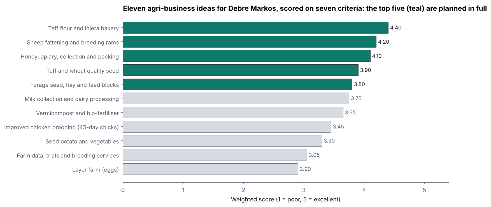
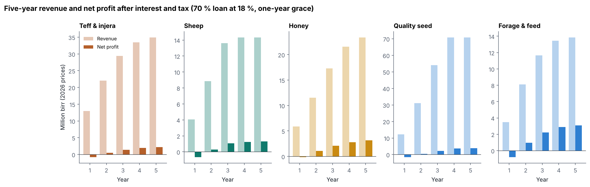
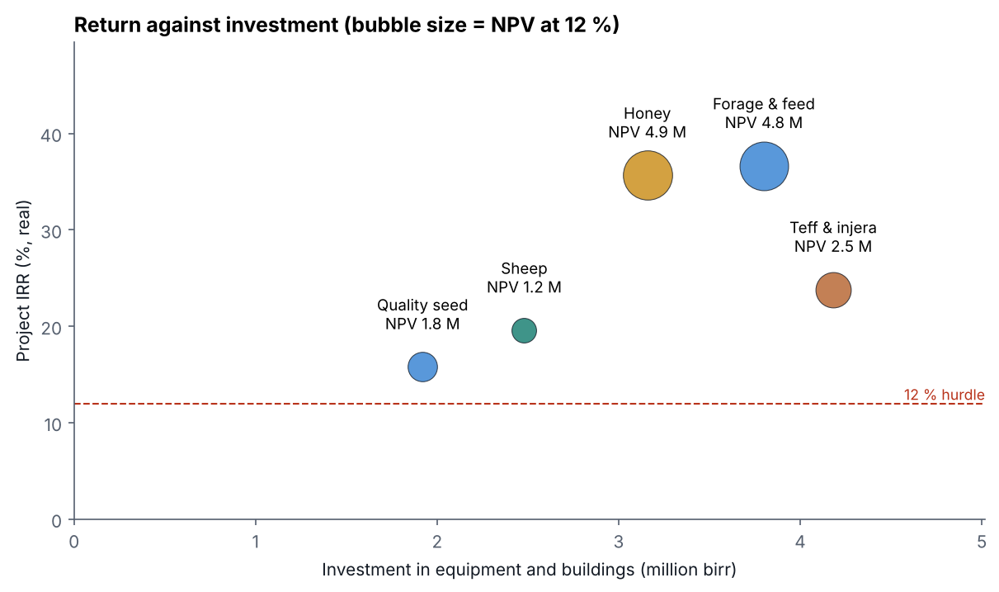
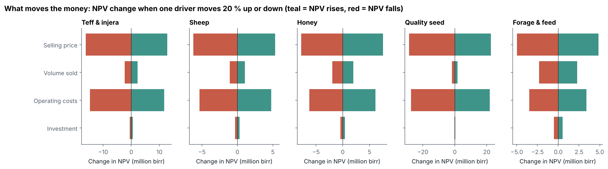

# Module 5 · Five agri-businesses to start around Debre Markos, A to Z

**ሞጁል 5 · በደብረ ማርቆስ አካባቢ የሚጀመሩ አምስት የግብርና ንግዶች፣ ከሀ እስከ ፐ**

> **The business question.** You live in or near Debre Markos (East Gojjam, Amhara) and have some savings, land or a group of farmers. Which agri-business should you start first, how much does it cost, what will it earn, which licences do you need, and how do you keep it alive when roads close or prices jump?

This module picks five businesses with a transparent score. For each it gives a full plan and a five-year financial model you can rerun with your own numbers.

**How to read the numbers:**
- **Prices** come from 2025–2026 national or Addis Ababa reports (linked). Local Debre Markos prices are usually lower, so every local price is marked as an **assumption**. Replace it with quotes you collect in the market before you borrow money.
- **Model settings:** all values are in birr at 2026 prices. Imported equipment is converted at 160 birr per US dollar.
- **To change anything:** edit the dictionaries at the top of [`run.py`](run.py) and run it again. The tables, charts and this guide update.

---

## 0 · The ground: what Debre Markos offers, and what threatens a business

**What it offers:**

- **Teff country.** East Gojjam is the leading teff zone of Ethiopia. Teff is its primary cereal, about 23 % of the zone's food grain ([J. Agric. Environ. Sci.](https://ejol.aau.edu.et/index.php/JAES/article/download/10280/8903/24369)). A national survey put its average farm altitude at about 2,323 m ([IFPRI](https://cgspace.cgiar.org/server/api/core/bitstreams/92c12624-9fe1-48e6-8472-bce45e557d67/content)).
- **Diverse farming.** Besides grains and pulses, the zone grows high-value potatoes, onions and garlic (Senan woreda). Choke Mountain is a water tower of the upper Blue Nile with over 60 rivers ([Debre Markos University](https://www.dmu.edu.et)).
- **A university partner.** Debre Markos University runs a centre of excellence in crop productivity and agro-processing. Its stated aims include introducing selected seeds and helping entrepreneurs start agro-processing enterprises ([DMU](https://rcs.dmu.edu.et/?p=536)).
- **Low use of improved teff seed.** Only 7.6 % of Amhara's teff area was sown with improved seed. Community seed producers supplied 62 % of what was distributed ([J. Agric. Environ. Sci.](https://ejol.aau.edu.et/index.php/JAES/article/download/13226/9372/27854)).

**What threatens a business (be honest with yourself and your lender):**

- **Insecurity.** Since 2023, Amhara has been the scene of a war between the government and the Fano militia. Ambushes on the roads between towns have repeatedly cut them off ([UCDP](https://ucdp.uu.se/conflict/16069)). Clashes were reported in and around Debre Markos itself in early 2026 ([Fenix Insight](https://metis.fenixinsight.com/event/578765)).
- **Costs and money.** The birr floats: about 159–160 birr per US dollar at the November 2026 central bank auction ([Capital](https://capitalethiopia.com/?p=84151)). The policy rate is 16 %, and annual inflation was 14.9 % in September ([Rio Times](https://www.riotimesonline.com/?p=785748)). Imported machines, feed and fuel rise with the dollar.

**Design rules that follow from this (built into all five plans):**

1. **Sell locally first.** Debre Markos town, Bahir Dar and nearby woreda markets come first. Addis Ababa is a bonus, not the base.
2. **Grow in steps.** Start at a third of the full size, and add the second step only after six months of positive cash.
3. **Keep stock and cash small.** Turn stock fast, use mobile money and bank accounts, and hold no large cash.
4. **Prefer local machines and local materials.** Lease where you can; import only what no Ethiopian workshop makes.
5. **Work through farmers' groups.** Seed producer cooperatives, beekeeper groups and breeding villages spread the risk and the supply.
6. **Keep a plan B site.** The same five plans work in any highland teff and livestock area: around Bahir Dar, Debre Birhan, Holeta, Ambo, Woliso or Bishoftu.

---

## 1 · Choosing: eleven ideas, seven criteria

| Idea | Local resource fit | Proven demand and price | Low capital need | Fast first cash | Keeps running if roads close | Jobs and farmers reached | Uses this curriculum | Weighted score |
|---|---|---|---|---|---|---|---|---|
| Teff flour and injera bakery | 5 | 5 | 4 | 5 | 4 | 4 | 3 | 4.40 |
| Sheep fattening and breeding rams | 4 | 5 | 4 | 4 | 4 | 3 | 5 | 4.20 |
| Honey: apiary, collection and packing | 5 | 4 | 4 | 3 | 4 | 5 | 3 | 4.10 |
| Teff and wheat quality seed | 5 | 4 | 3 | 2 | 3 | 5 | 5 | 3.90 |
| Forage seed, hay and feed blocks | 4 | 4 | 4 | 3 | 4 | 4 | 3 | 3.80 |
| Milk collection and dairy processing | 4 | 5 | 2 | 4 | 3 | 5 | 3 | 3.75 |
| Vermicompost and bio-fertiliser | 4 | 3 | 5 | 4 | 4 | 3 | 2 | 3.65 |
| Improved chicken brooding (45-day chicks) | 3 | 4 | 4 | 4 | 3 | 4 | 2 | 3.45 |
| Seed potato and vegetables | 4 | 3 | 3 | 3 | 3 | 4 | 3 | 3.30 |
| Farm data, trials and breeding services | 3 | 2 | 5 | 3 | 2 | 2 | 5 | 3.05 |
| Layer farm (eggs) | 3 | 3 | 3 | 3 | 3 | 3 | 2 | 2.90 |

Weights:
- local resource fit 20 %;
- proven demand and price 20 %;
- low capital need 15 %;
- keeps running if roads close 15 %;
- fast first cash 10 %;
- jobs and farmers reached 10 %;
- uses this curriculum 10 %.

The scores are the author's judgement, and you can change them in `run.py`. Dairy processing scored well on demand but needs the most imported equipment and a daily cold chain, which is fragile when roads close. It is the first idea to add once the top five are running.

**The five selected:** Teff flour and injera bakery, Sheep fattening and breeding rams, Honey: apiary, collection and packing, Teff and wheat quality seed, Forage seed, hay and feed blocks.

---

## 2 · The five at a glance

| Business | Investment (M birr) | Your equity (M birr) | Revenue yr 4 (M) | Net profit yr 4 (M) | NPV 12 % (M) | IRR % | Payback (years) | Min DSCR |
|---|---|---|---|---|---|---|---|---|
| Teff flour and injera bakery | 4.18 | 1.57 | 33.50 | 1.93 | 2.53 | 23.80 | 3.90 | 0.63 |
| Sheep fattening and breeding rams | 2.48 | 1.05 | 14.34 | 1.23 | 1.23 | 19.57 | 4.24 | 0.08 |
| Honey: apiary, collection and packing | 3.16 | 1.33 | 21.55 | 2.80 | 4.92 | 35.65 | 3.44 | 1.48 |
| Teff and wheat quality seed | 1.92 | 1.84 | 70.85 | 3.70 | 1.75 | 15.77 | 4.59 | -0.69 |
| Forage seed, hay and feed blocks | 3.80 | 1.30 | 13.44 | 2.88 | 4.80 | 36.63 | 3.00 | 0.43 |

How to read these:
- **Every business loses money or only breaks even in year 1.** Budget your equity to carry that year. The one-year grace period on loan principal is built in.
- **DSCR** (cash available ÷ loan payments) must be above 1.2 from year 2 for most banks. Where it is lower in year 1, start smaller or raise more equity.
- **The tornado chart** shows that two numbers drive profit in every business: the **selling price** and the **purchase price of the raw material** (teff, raw seed, honey, young rams). Both sit inside "operating costs". A 20 % move in either can wipe out the NPV, while a 20 % change in the investment hardly matters. So **contracts with suppliers, buying at harvest, holiday timing, grading and branding matter more than cheaper machines**.

---

## 3 · Business 1: Teff flour and injera bakery

**What:** buy clean white and red teff from East Gojjam farmers and cooperatives. Clean and mill it into packed flour (5 kg and 25 kg bags), and bake injera every day for hotels, restaurants, university cafeterias, offices and households.

**Why it fits:**
- **Supply:** the best teff grows around you.
- **Demand:** teff is the staple, and its price more than doubled from 7,000 birr a quintal in 2023 to about 15,000 in Addis Ababa in 2025 ([The Reporter](https://thereportermagazines.com/3678/)). Busy urban families buy injera instead of baking it.
- **Yield of injera:** about 500 injera come from one quintal of red teff ([IFPRI](https://cgspace.cgiar.org/server/api/core/bitstreams/f09f0754-5567-4a68-bdf6-67b0ecbdeb40/content)).
- **Export:** injera exports to diaspora markets exist, with a floor price of USD 1.35 a piece set for the US ([The Reporter](https://www.thereporterethiopia.com/37998/)). This is a later step that needs food-safety certification and Addis logistics.

**Customers:** hotels and restaurants in Debre Markos, university and hospital cafeterias, civil-servant households (weekly subscription), shops in Bahir Dar, and flour wholesalers in Addis.

**Site:** a rented building with three-phase power in Debre Markos town, near a market, with a clean baking hall and a dry store.

**Licences:** trade name clearance, business licence and TIN on the Ministry of Trade's **eTrade** portal. Digital registration and renewal became mandatory, and the renewal fee was about 102 birr in 2025 ([Fortune](https://addisfortune.news/?p=24829)). Also needed: a food-establishment health and hygiene licence from the regional food and health regulator, health certificates for staff, and a product label with weight, date and address.

**Team:** manager, 8 bakers (mostly women), mill operator and 2 helpers, 2 sales and delivery staff.

**Investment:**

| Investment item | Birr |
|---|---|
| Teff cleaner and destoner | 720,000 |
| Stone/hammer mill, 1 t/day | 960,000 |
| Electric mitads (24) and baking hall fit-out | 782,000 |
| Packing scale, sealer, shelves | 220,000 |
| Store and premises improvement (rented building) | 600,000 |
| Cargo three-wheeler | 900,000 |
| **Total** | 4,182,000 |

**Fixed costs:**

| Fixed cost per year | Birr |
|---|---|
| Manager | 300,000 |
| Bakers (8) | 864,000 |
| Mill operator and helpers (3) | 324,000 |
| Sales and delivery (2) | 240,000 |
| Rent | 360,000 |
| Licences, food safety, insurance | 120,000 |
| **Total** | 2,208,000 |

**Products and unit margins:**

| Product | Volume year 1 → year 4 | Price (birr/unit) | Variable cost (birr/unit) | Margin per unit |
|---|---|---|---|---|
| Injera (pieces) | 180,000 → 330,000 | 40 | 29 | 11 |
| Packed white teff flour (quintals) | 400 → 1,400 | 14,500 | 12,900 | 1,600 |

**Five-year results:** Investment **4.2 M birr** + start-up working capital 1.0 M · equity 1.6 M, loan 3.7 M · NPV at 12 % **2.5 M birr** · IRR **24 %** · payback **3.9 years** · break-even at **38 %** of year-4 sales

| Year | Revenue (M birr) | Variable costs (M birr) | Fixed costs (M birr) | EBITDA (M birr) | Interest (M birr) | Net profit (M birr) | DSCR |
|---|---|---|---|---|---|---|---|
| 1.00 | 13.00 | 10.38 | 2.21 | 0.41 | 0.66 | -0.77 | 0.63 |
| 2.00 | 22.00 | 17.86 | 2.21 | 1.93 | 0.66 | 0.53 | 1.25 |
| 3.00 | 29.40 | 24.18 | 2.21 | 3.01 | 0.53 | 1.37 | 1.78 |
| 4.00 | 33.50 | 27.63 | 2.21 | 3.66 | 0.38 | 1.93 | 2.08 |
| 5.00 | 34.95 | 28.92 | 2.21 | 3.82 | 0.21 | 2.16 | 2.13 |

**Operations calendar:**
- **November to January:** buy most of the year's teff after the meher harvest, when prices are lowest; the store must hold 2–3 months.
- **Every day:** bake to order.
- **Before holidays:** add a shift.

**Risks and fixes:**

| Risk | Fix |
|---|---|
| Teff price jumps | Buy at harvest; pre-agreed price with 2–3 cooperatives; adjust injera price monthly |
| Power cuts | Mix of electric and efficient biomass mitads; schedule baking at night |
| Quality complaints (sour, thin, mould) | Standard recipe (fermentation time and ratio), daily tasting, sell within 2 days |
| Roads to Addis close | The flour line is the flexible part: sell locally or store; injera is local anyway |

**First 90 days:**
1. Test 3 recipes and price points with 10 hotels.
2. Sign 2 cooperative supply agreements.
3. Register on eTrade and obtain the food licence.
4. Start with 8 mitads and 300 injera a day.

**Curriculum link:** Module 1 (which teff varieties farmers should grow for colour and yield) and the [crop advisor](../../crops/).

---

## 4 · Business 2: Sheep fattening and breeding rams

**What:** buy young rams in Gojjam markets and fatten them for 90 days on hay, crop residue and a measured concentrate. Sell by weight for the holidays, and resell EBV-ranked breeding rams from partner breeding villages.

**Why it fits:**
- **Demand:** holiday demand is strong. Sheep sold for 12,000–45,000 birr at an Addis market in May 2026 ([The Reporter](https://www.thereporterethiopia.com/46976/)).
- **Supply:** Washera and Gojjam highland sheep are the local base.
- **Method:** the full breeding and fattening method is in Module 4.

**Customers:** households before Meskel, Christmas, Timket and Easter; butchers and hotels; traders to Bahir Dar and Addis; and other villages buying breeding rams.

**Site:** 2 ha at the edge of town with water, a fattening shed for 300 head, a feed store and a quarantine pen.

**Licences:** eTrade business licence and TIN; registration with the woreda livestock office; veterinary health certificates for animals moved between woredas.

**Team:** livestock technician (manager), 4 herders, guard, contract veterinarian.

**Investment:**

| Investment item | Birr |
|---|---|
| Fattening shed and pens, 300 head (local materials, iron roof) | 1,400,000 |
| Feed store | 350,000 |
| Animal scale, feeders, water troughs | 180,000 |
| Forage chopper | 400,000 |
| Handling race and quarantine pen | 150,000 |
| **Total** | 2,480,000 |

**Fixed costs:**

| Fixed cost per year | Birr |
|---|---|
| Manager / livestock technician | 264,000 |
| Herders (4) | 384,000 |
| Guard | 84,000 |
| Vet contract and records | 60,000 |
| Land rent, 2 ha | 80,000 |
| **Total** | 872,000 |

**Products and unit margins:**

| Product | Volume year 1 → year 4 | Price (birr/unit) | Variable cost (birr/unit) | Margin per unit |
|---|---|---|---|---|
| Finished rams sold | 291 → 873 | 13,950 | 10,837 | 3,113 |
| Breeding rams from partner CBBP villages (resale) | 0 → 120 | 18,000 | 14,500 | 3,500 |

**Five-year results:** Investment **2.5 M birr** + start-up working capital 1.0 M · equity 1.0 M, loan 2.4 M · NPV at 12 % **1.2 M birr** · IRR **20 %** · payback **4.2 years** · break-even at **28 %** of year-4 sales

| Year | Revenue (M birr) | Variable costs (M birr) | Fixed costs (M birr) | EBITDA (M birr) | Interest (M birr) | Net profit (M birr) | DSCR |
|---|---|---|---|---|---|---|---|
| 1.00 | 4.06 | 3.15 | 0.87 | 0.03 | 0.44 | -0.65 | 0.08 |
| 2.00 | 8.84 | 6.89 | 0.87 | 1.08 | 0.44 | 0.27 | 1.06 |
| 3.00 | 13.62 | 10.62 | 0.87 | 2.13 | 0.36 | 1.07 | 1.84 |
| 4.00 | 14.34 | 11.20 | 0.87 | 2.27 | 0.26 | 1.23 | 1.91 |
| 5.00 | 14.34 | 11.20 | 0.87 | 2.27 | 0.14 | 1.32 | 1.88 |

**Operations calendar:** three 90-day cycles a year, each ending 1–2 weeks before a major holiday. Within each cycle:
- **Days 1–21:** buy, then quarantine, vaccinate and deworm.
- **Days 22–90:** fatten.
- **Every two weeks:** weigh the animals.
- **Last 10 days:** sell.

**Risks and fixes:**

| Risk | Fix |
|---|---|
| Buying price rises before the holiday | Buy early in the cycle; contract young rams from breeding villages |
| Disease (PPR, pasteurellosis, sheep pox) | Vaccinate on arrival, quarantine, keep death records (Module 4, Step 5) |
| Feed price | Produce your own hay (Business 5); test rations on a few pens first |
| Animals cannot be moved | Sell in Debre Markos and nearby markets; holidays happen everywhere |

**First 90 days:**
1. Build pens from local materials.
2. Agree supply with 2 breeding-group villages.
3. Buy the first 100 rams 100 days before a holiday.
4. Weigh everything, every two weeks.

**Curriculum link:** Modules 2 and 4.

---

## 5 · Business 3: Honey: apiary, collection and packing

**What:** a 200-hive modern apiary plus a collection network buying strained honey from local beekeepers. A food-grade honey house extracts, settles, filters and packs labelled Gojjam honey in jars. Beeswax is sold as a second product.

**Why it fits:** the price gap is large. Honey sold for less than 400 birr a kilogram at production level but fetched up to 800 birr in Addis Ababa ([Capital, 2025](https://capitalethiopia.com/2025/03/31/honey-boom-faces-market-challenges-despite-high-potential/)). Ethiopia was the world's fifth-largest producer in 2024 ([Selina Wamucii](https://www.selinawamucii.com/insights/prices/ethiopia/natural-honey/)). Gojjam honey is already a known name in Addis shops. A detailed honey plan for beginners is in the [Tech Stories honey business plan](https://muler-21.github.io/Teck_Stories/honey-business-plan/).

**Customers:** supermarkets and shops in Debre Markos, Bahir Dar and Addis; hotels; gift packs for holidays; and, later, exporters (which needs residue testing and traceability).

**Site:** apiary sites in flowering areas (around Choke foothills, river valleys) with farmers' agreement, and a small honey house in town.

**Licences:** eTrade licence and TIN; food-establishment hygiene licence for the honey house; product labels; Ethiopian honey quality standard testing (moisture, HMF, adulteration) before supplying supermarkets.

**Team:** apiculturist manager, 3 beekeepers, 2 processing and packing staff.

**Investment:**

| Investment item | Birr |
|---|---|
| Modern hives with colonies (200) | 1,800,000 |
| Extractor, uncapping tray, settling tanks | 560,000 |
| Honey house fit-out (food grade) | 450,000 |
| Jar filler, labels, refractometer | 288,000 |
| Protective kits and smoker (20) | 60,000 |
| **Total** | 3,158,000 |

**Fixed costs:**

| Fixed cost per year | Birr |
|---|---|
| Manager / apiculturist | 264,000 |
| Beekeepers (3) | 324,000 |
| Processing and packing (2) | 216,000 |
| Sales, transport to Bahir Dar and Addis | 180,000 |
| Licences, food safety, insurance | 80,000 |
| **Total** | 1,064,000 |

**Products and unit margins:**

| Product | Volume year 1 → year 4 | Price (birr/unit) | Variable cost (birr/unit) | Margin per unit |
|---|---|---|---|---|
| Own apiary honey (kg) | 1,600 → 3,200 | 600 | 45 | 555 |
| Collected strained honey from member beekeepers (kg) | 8,000 → 32,000 | 600 | 487 | 113 |
| Beeswax (kg) | 150 → 620 | 700 | 60 | 640 |

**Five-year results:** Investment **3.2 M birr** + start-up working capital 1.3 M · equity 1.3 M, loan 3.1 M · NPV at 12 % **4.9 M birr** · IRR **36 %** · payback **3.4 years** · break-even at **18 %** of year-4 sales

| Year | Revenue (M birr) | Variable costs (M birr) | Fixed costs (M birr) | EBITDA (M birr) | Interest (M birr) | Net profit (M birr) | DSCR |
|---|---|---|---|---|---|---|---|
| 1.00 | 5.87 | 3.98 | 1.06 | 0.82 | 0.56 | -0.13 | 1.48 |
| 2.00 | 11.53 | 7.94 | 1.06 | 2.52 | 0.56 | 1.10 | 1.78 |
| 3.00 | 17.27 | 12.35 | 1.06 | 3.85 | 0.45 | 2.11 | 2.57 |
| 4.00 | 21.55 | 15.77 | 1.06 | 4.72 | 0.32 | 2.80 | 3.06 |
| 5.00 | 23.40 | 17.23 | 1.06 | 5.10 | 0.18 | 3.17 | 3.25 |

**Operations calendar:**
- **Main flow:** after the rains, roughly October to December. Buy most collected honey then, when the price is lowest. Honey prices rise from February as supply falls ([Fortune](https://addisfortune.net/articles/sweet-business/)).
- **Second harvest:** where flowering allows.
- **Dearth period:** feed the colonies and split them.

**Risks and fixes:**

| Risk | Fix |
|---|---|
| Adulterated honey from suppliers | Test every lot (moisture, refractometer, simple purity tests); pay quality premiums; register suppliers |
| Pesticide use on crops kills colonies | Agreements with neighbours; site hives away from sprayed fields |
| Price competition in Addis | Sell a brand with origin (Gojjam, Choke), clean jars, and consistent quality |
| Roads close | Honey keeps for a long time: store and sell later or locally |

**First 90 days:**
1. Register 50 beekeeper suppliers.
2. Buy and test the first 2 tonnes.
3. Design the label.
4. Sign with 5 shops.
5. Install the first 50 hives with colonies.

**Curriculum link:** the honeybee entries in the [catalogue](../../catalogue/).

---

## 6 · Business 4: Teff and wheat quality seed

**What:** a seed company or seed producer cooperative working with 60 contract farmers in year 1, rising to 250. They grow released varieties of teff (Module 1 and 3 thinking: Quncho, Kora and newer ones) and bread wheat under inspection. The business cleans, tests, bags and sells Quality Declared or certified seed.

**Why it fits:**
- **Unmet demand at home:** East Gojjam is the leading teff zone, yet only a small share of teff is sown with improved seed, and community producers already supply most of it.
- **Price:** seed sells at a premium over grain.
- **A university partner:** Debre Markos University's centre of excellence aims to introduce selected seeds.

**Customers:** farmers through cooperatives and direct seed marketing outlets, woreda agriculture offices, NGOs, and Bahir Dar and Addis traders for wheat.

**Site:** a rented store in Debre Markos with a cleaning room; contract farms in surrounding woredas, chosen for isolation and good roads.

**Licences:**
- A **certificate of competence** is required: anyone who intends to produce seed commercially must hold one and must set up an internal seed quality control system ([Seed Proclamation 782/2013, FAOLEX](https://leap.unep.org/en/countries/et/national-legislation/seed-proclamation-no7822013)).
- Seed field inspection and lab testing by the regional seed quality control laboratory.
- An agreement with the variety owner (research centre) for early-generation (basic) seed.
- eTrade licence and TIN.

**Team:** agronomist manager, 2 field supervisors, 3 store and cleaning workers.

**Investment:**

| Investment item | Birr |
|---|---|
| Seed cleaner-grader, locally made, 1 t/h | 850,000 |
| Rented store fit-out (pallets, ventilation, fumigation) | 450,000 |
| Moisture meter, germination kit, scales | 350,000 |
| Bag sewing machine and label printing | 120,000 |
| Demonstration and isolation plots equipment | 150,000 |
| **Total** | 1,920,000 |

**Fixed costs:**

| Fixed cost per year | Birr |
|---|---|
| Seed manager (agronomist) | 336,000 |
| Field supervisors (2) | 360,000 |
| Store and cleaning workers (3) | 324,000 |
| Store rent | 300,000 |
| Certification, inspection, CoC renewal | 150,000 |
| Transport hire | 200,000 |
| Demonstration plots and promotion | 200,000 |
| Insurance | 60,000 |
| **Total** | 1,930,000 |

**Products and unit margins:**

| Product | Volume year 1 → year 4 | Price (birr/unit) | Variable cost (birr/unit) | Margin per unit |
|---|---|---|---|---|
| Certified/QDS teff seed (quintals) | 810 → 3,375 | 15,000 | 13,278 | 1,722 |
| Bread wheat seed (quintals) | 0 → 1,890 | 10,700 | 9,617 | 1,083 |

**Five-year results:** Investment **1.9 M birr** + start-up working capital 4.2 M · equity 1.8 M, loan 4.3 M · NPV at 12 % **1.8 M birr** · IRR **16 %** · payback **4.6 years** · break-even at **25 %** of year-4 sales

| Year | Revenue (M birr) | Variable costs (M birr) | Fixed costs (M birr) | EBITDA (M birr) | Interest (M birr) | Net profit (M birr) | DSCR |
|---|---|---|---|---|---|---|---|
| 1.00 | 12.15 | 10.76 | 1.93 | -0.54 | 0.77 | -1.50 | -0.69 |
| 2.00 | 31.04 | 27.57 | 1.93 | 1.54 | 0.77 | 0.40 | 0.86 |
| 3.00 | 53.98 | 47.97 | 1.93 | 4.08 | 0.63 | 2.29 | 1.94 |
| 4.00 | 70.85 | 62.99 | 1.93 | 5.93 | 0.45 | 3.70 | 2.72 |
| 5.00 | 70.85 | 62.99 | 1.93 | 5.93 | 0.24 | 3.85 | 2.68 |

**Operations calendar:**
- **March to April:** contract the farmers and deliver basic seed.
- **June to July:** planting, then 2–3 field inspections.
- **November to December:** harvest and buy the raw seed.
- **December to March:** clean, test and bag.
- **April to June:** sell before planting.

Cash is tied up for about 6 months. That is why the start-up working capital is the largest of the five businesses.

**Risks and fixes:**

| Risk | Fix |
|---|---|
| Farmers side-sell raw seed as grain | Pay grain +10 % promptly in cash or mobile money; advance the basic seed; keep loyalty bonuses |
| Seed fails inspection | Choose isolated fields; train farmers; rogue off-types at flowering |
| Unsold seed | Sell to cooperatives on order; whatever fails or is left over goes back to the grain market (built into the model) |
| Weak teff seed demand: farmers recycle seed | Show the gain with demonstration plots (the model includes a budget); offer small packs |

**First 90 days:**
1. Apply for the certificate of competence.
2. Agree basic seed with the regional research centre.
3. Recruit 60 farmers in 2–3 kebeles.
4. Rent and fit the store.

**Curriculum link:** Modules 1 and 3, and the [crop advisor](../../crops/).

---

## 7 · Business 5: Forage seed, hay and feed blocks

**What:** grow oats-vetch and perennial grasses (Desho, Rhodes) on 20 rented hectares. Bale and sell hay, press urea-molasses nutrient blocks, and sell forage seed and grass splits to livestock keepers.

**Why it fits:** feed is the binding constraint of every livestock business here. Ethiopia's agriculture ministry says the main reason milk, meat, egg and poultry prices doubled or even tripled is the price of animal feed ([Capital](https://capitalethiopia.com/2025/10/19/pmo-takes-direct-control-of-strategic-commodity-management-following-fertilizer-scandal-2/)). This business also feeds Business 2 and lowers its cost.

**Customers:** sheep and cattle fatteners, dairy farmers around town, the sheep business (Business 2), and NGOs buying forage seed.

**Site:** 20 ha of rented land with a hay barn, near the sheep unit.

**Licences:** eTrade licence and TIN. For selling forage seed, the same seed rules as Business 4 apply (certificate of competence), or sell planting material (splits) through the woreda office.

**Team:** animal-science manager, 5 workers; tractor hire.

**Investment:**

| Investment item | Birr |
|---|---|
| Hay baler (small, tractor-hire) and rakes | 1,440,000 |
| Hay barn 300 m² | 1,200,000 |
| Feed-block press and mixer | 640,000 |
| Forage seed cleaner | 400,000 |
| Scales and moisture meter | 120,000 |
| **Total** | 3,800,000 |

**Fixed costs:**

| Fixed cost per year | Birr |
|---|---|
| Manager (animal scientist) | 288,000 |
| Workers (5) | 510,000 |
| Tractor hire and fuel | 300,000 |
| Land rent 20 ha (oats-vetch, Desho, Rhodes) | 240,000 |
| Promotion and demos | 100,000 |
| **Total** | 1,438,000 |

**Products and unit margins:**

| Product | Volume year 1 → year 4 | Price (birr/unit) | Variable cost (birr/unit) | Margin per unit |
|---|---|---|---|---|
| Oats-vetch and grass hay bales (25 kg) | 6,000 → 18,000 | 320 | 150 | 170 |
| Urea-molasses multi-nutrient blocks (pieces) | 3,000 → 14,000 | 420 | 260 | 160 |
| Forage seed and splits (kg) | 500 → 3,000 | 600 | 250 | 350 |

**Five-year results:** Investment **3.8 M birr** + start-up working capital 0.5 M · equity 1.3 M, loan 3.0 M · NPV at 12 % **4.8 M birr** · IRR **37 %** · payback **3.0 years** · break-even at **23 %** of year-4 sales

| Year | Revenue (M birr) | Variable costs (M birr) | Fixed costs (M birr) | EBITDA (M birr) | Interest (M birr) | Net profit (M birr) | DSCR |
|---|---|---|---|---|---|---|---|
| 1.00 | 3.48 | 1.80 | 1.44 | 0.24 | 0.55 | -0.78 | 0.43 |
| 2.00 | 8.10 | 4.25 | 1.44 | 2.41 | 0.55 | 0.97 | 1.76 |
| 3.00 | 11.66 | 6.14 | 1.44 | 4.08 | 0.44 | 2.21 | 2.77 |
| 4.00 | 13.44 | 7.09 | 1.44 | 4.91 | 0.32 | 2.88 | 3.25 |
| 5.00 | 13.86 | 7.35 | 1.44 | 5.07 | 0.17 | 3.10 | 3.32 |

**Operations calendar:**
- **June to July:** sow oats-vetch with the rains.
- **September to October:** cut and bale.
- **Dry season (January to May):** sell, when hay prices are highest.
- **Perennial grasses:** cut 3–4 times a year.
- **Blocks:** press all year.

**Risks and fixes:**

| Risk | Fix |
|---|---|
| Rain at cutting time spoils hay | Stagger sowing; cover stacks; buy a moisture meter |
| Buyers cannot pay in the wet season | Pre-sell with deposits; supply Business 2 first |
| Land rent rises | Multi-year written rent agreements with the kebele and owners |

**First 90 days:**
1. Rent land.
2. Sow 5 ha as a pilot.
3. Make 200 test blocks and sell them to 20 fatteners.
4. Record each buyer.

**Curriculum link:** Module 2 (goat fattening trial design) and Module 4 (fattening).

---

## 8 · Money: where it comes from

| Source | What it offers | What it asks |
|---|---|---|
| **Your equity** (savings, family, partners) | Control | At least 20–30 % of the project |
| **Tsedey Bank** (formerly Amhara Credit & Savings Institution, ACSI) | Loans to Amhara businesses, from small group loans up to SME loans | Business plan, collateral or group guarantee, savings history. It became a commercial bank in 2022, and Amhara instability has disrupted repayments and branches ([Fortune](https://addisfortune.news/?p=48613)) |
| **Development Bank of Ethiopia (DBE)** | Lease financing for machines (cleaners, mills, balers, choppers) for agro-processing and SMEs; interest-free options | Typically 20–30 % equity and a feasibility study. It has cut back funding for rain-fed farming but still leases mechanisation ([Fortune](https://addisfortune.news/investors-press-policy-bank-rethink-rain-fed-agriculture-funding)) |
| **Commercial banks** (Awash, Dashen, Abay, CBE) | Working-capital loans | Collateral, cash-flow history |
| **Projects and partners** | Grants, matching funds, training: e.g. seed sector partnerships, NGO value-chain programmes, Debre Markos University | A clear plan, farmer reach, reporting |

**Model settings** (all in `run.py`):
- **Funding split:** 30 % equity and 70 % loan, at 18 % for 5 years with a 1-year grace period on principal.
- **Tax:** 30 % on profit.
- **Hurdle rate:** NPV uses a 12 % real hurdle rate.

---

## 9 · A to Z: the launch checklist (same for all five)

| | Step | Done when |
|---|---|---|
| **A** | **Assess** the market: visit 3 markets, 10 buyers, 10 suppliers; write down prices | A one-page price sheet with dates |
| **B** | **Business model** chosen from the five; partner(s) agreed | Signed partnership agreement |
| **C** | **Customers** named: 10 who say "yes, I would buy at this price" | List with phone numbers |
| **D** | **Decide the legal form**: sole proprietor, PLC or cooperative | Form chosen; cooperative bylaws or memorandum drafted |
| **E** | **eTrade**: trade name clearance, registration, business licence | Licence printed |
| **F** | **Finance**: equity in the bank; loan application with this module's model | Approval letter |
| **G** | **Get the certificates**: certificate of competence (seed), food hygiene (injera, honey), veterinary (sheep) | Certificates on the wall |
| **H** | **Hire** the manager first, then the team; written contracts | Contracts signed |
| **I** | **Infrastructure**: rent and fit the site; power, water, security | Site inspected |
| **J** | **Joint suppliers**: written agreements with cooperatives, beekeepers, breeding villages | Signed supply agreements |
| **K** | **Keep records** from day 1: stock, sales, costs, animals, lots | Ledger or app in daily use |
| **L** | **Label and brand**: name, logo, label with weight, date, origin | Label printed |
| **M** | **Machines** bought or leased; staff trained on them | Test run passed |
| **N** | **Numbers**: rerun `run.py` with your real quotes | Updated model saved |
| **O** | **Open with a pilot** at one-third size | First batch sold |
| **P** | **Price** reviewed monthly against costs | Price sheet updated monthly |
| **Q** | **Quality control**: tests, tasting, inspection, rejects recorded | QC log in use |
| **R** | **Risk plan**: insurance, stock limits, alternative routes and buyers, cash rules | Written one-page plan |
| **S** | **Sales channels**: shops, hotels, cooperatives, phone and Telegram orders | 3 channels active |
| **T** | **Taxes**: VAT or turnover tax registration, monthly or quarterly filing | First return filed |
| **U** | **University and research links**: DMU, the regional research institute, extension | One agreement or joint trial |
| **V** | **Value addition next**: second product (flour → injera, honey → wax, seed → wheat) | Second line launched |
| **W** | **Workers' safety and welfare**: protective kit, first aid, fair pay | Safety checklist |
| **X** | **eXpand** only after 6 months of positive cash flow | Board or partners' decision |
| **Y** | **Year-end review**: accounts, audit if a PLC, lessons | Annual report |
| **Z** | **Zero waste**: by-products sold (bran, wax, manure, rejects as grain) | By-product sales recorded |

---

## በአማርኛ አጭር ማጠቃለያ

- **ምርጫ:** 11 የንግድ ሐሳቦችን በ7 መስፈርቶች መዝነን 5ቱን መርጠናል፦ የጤፍ ዱቄትና የእንጀራ መጋገሪያ፣ በግ ማድለብና የአውራ በግ ሽያጭ፣ የማር ንብ እርባታና ማሸጊያ፣ የጤፍና የስንዴ ጥራት ያለው ዘር፣ የመኖ ዘር፣ ድርቆሽና የመኖ ብሎክ።
- **ቦታው:** ምሥራቅ ጎጃም ቀዳሚ የጤፍ ዞን ነው፤ ደብረ ማርቆስ ዩኒቨርሲቲ በሰብል ምርታማነትና በግብርና ማቀነባበር የልህቀት ማዕከል አለው።
- **አደጋው:** የፀጥታ ችግርና የመንገድ መዘጋት፣ የብር ምንዛሪ (በዶላር ወደ 160 ብር)፣ የዋጋ ንረት። ስለዚህ በአካባቢው ገበያ ይጀምሩ፣ በሦስተኛው መጠን ይጀምሩ፣ ክምችትና ጥሬ ገንዘብ ትንሽ ያድርጉ፣ በማኅበራት በኩል ይሥሩ።
- **ገንዘብ:** 30 % የራስ ገንዘብ፣ 70 % ብድር (ፀደይ ባንክ፣ የኢትዮጵያ ልማት ባንክ የማሽን ሊዝ፣ የንግድ ባንኮች)። በመጀመሪያው ዓመት ሁሉም ንግዶች ኪሳራ ወይም ትንሽ ትርፍ ስለሚያሳዩ ያንን ዓመት የሚሸፍን ገንዘብ ያዘጋጁ።
- **ትርፍን የሚወስነው:** የሽያጭ ዋጋ ነው። ውል፣ በዓላትን ማስላት፣ ደረጃ መለየትና ብራንድ ወጪን ከመቀነስ በላይ ይጠቅማሉ።
- **ፈቃድ:** ሁሉም በኢትሬድ (eTrade) የንግድ ፈቃድና የግብር ከፋይ መለያ ቁጥር ይፈልጋሉ፤ ዘር የብቃት ማረጋገጫ ሰርተፊኬት፣ እንጀራና ማር የምግብ ንጽሕና ፈቃድ፣ በግ የእንስሳት ጤና ሰርተፊኬት ያስፈልጋቸዋል።
- **ከሀ እስከ ፐ:** ገበያ ማጥናት፣ ደንበኞችን መለየት፣ ፈቃድ፣ ብድር፣ ሠራተኛ፣ መዝገብ፣ ብራንድ፣ በሙከራ መጀመር፣ ጥራት፣ ግብር፣ ከዩኒቨርሲቲ ጋር መሥራት፣ ቆሻሻን መሸጥ።

## Sources

- **Debre Markos and East Gojjam:**
  - [Teff landraces in East Gojjam, J. Agric. Environ. Sci.](https://ejol.aau.edu.et/index.php/JAES/article/download/10280/8903/24369)
  - [IFPRI teff survey](https://cgspace.cgiar.org/server/api/core/bitstreams/92c12624-9fe1-48e6-8472-bce45e557d67/content)
  - [Debre Markos University](https://www.dmu.edu.et)
  - [DMU centre of excellence](https://rcs.dmu.edu.et/?p=536)
  - [Improved teff seed in Amhara](https://ejol.aau.edu.et/index.php/JAES/article/download/13226/9372/27854)
- **Security:**
  - [UCDP: Government/Amhara conflict](https://ucdp.uu.se/conflict/16069)
  - [CGRS security report on Amhara, May 2026](https://www.cgrs.be/sites/default/files/rapporten/coi_focus_ethiopie._veiligheidssituatie_in_amhara_20260528.pdf)
- **Macroeconomy:**
  - [Capital: NBE auction, Nov 2026](https://capitalethiopia.com/?p=84151)
  - [Rio Times: policy rate and inflation, Nov 2026](https://www.riotimesonline.com/?p=785748)
- **Prices:**
  - Teff: [The Reporter, 2025](https://thereportermagazines.com/3678/)
  - Wheat: [Capital, 2026](https://capitalethiopia.com/?p=79609)
  - Honey: [Capital, 2025](https://capitalethiopia.com/2025/03/31/honey-boom-faces-market-challenges-despite-high-potential/)
  - Sheep: [The Reporter, 2026](https://www.thereporterethiopia.com/46976/)
  - Milk: [Fortune, 2026](https://addisfortune.news/?p=41215)
  - Eggs and feed: [Fortune, 2025](https://addisfortune.news/polarity-in-supply-demand-for-eggs-disenchant-poultry-farmers)
  - Injera export: [The Reporter](https://www.thereporterethiopia.com/37998/)
- **Rules:**
  - [Seed Proclamation 782/2013](https://leap.unep.org/en/countries/et/national-legislation/seed-proclamation-no7822013)
  - [eTrade licensing](https://addisfortune.news/?p=24829)
- **Finance:**
  - [Tsedey Bank](https://addisfortune.news/?p=48613)
  - [Development Bank of Ethiopia](https://addisfortune.news/investors-press-policy-bank-rethink-rain-fed-agriculture-funding)

**Reproduce:** `python modules/05-five-businesses-debre-markos/run.py` (all assumptions are at the top of the file).
